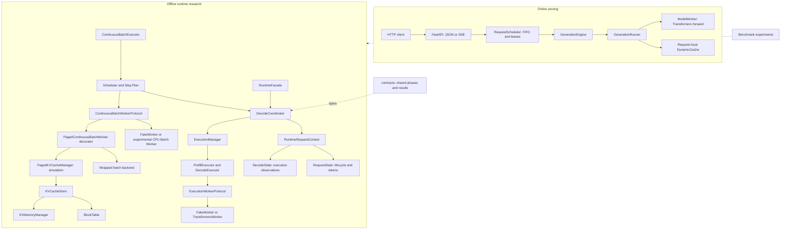

# MiniLLM-Serve

A compact LLM inference service and offline runtime research playground.
Explore scheduling, prefill/decode execution and KV ownership without hiding
the mechanics behind a production serving framework.

## Overview

The project separates two paths:

- **Online serving:** FastAPI, an OpenAI-compatible text Chat Completions subset,
  incremental SSE, handwritten autoregressive decoding, request-local KV cache
  and bounded FIFO admission.
- **Offline research:** model-independent runtime contracts, explicit request
  ownership, continuous decode-step coordination, experimental workers,
  simulated paged KV capacity and reproducible benchmark experiments.

MiniLLM-Serve is an educational engineering project, **not a production vLLM
replacement**. Offline experiments are not wired into the HTTP inference path.

Historical online validation used Qwen2.5-0.5B-Instruct on an RTX 5060 Laptop GPU,
PyTorch 2.11.0+cu128, CUDA 12.8, Transformers 5.17.0 and Accelerate 1.15.0.
See [published evidence](benchmarks/reports/benchmark-summary.md) and
[environment notes](benchmarks/reports/environment.md). These measurements do
not validate every later experimental backend.

## Architecture



The offline paths are alternatives, not additional HTTP pipeline stages.
Synthetic block IDs never enter model attention.

## Features

| Area | Capability | Boundary |
| --- | --- | --- |
| API | JSON completions, token usage, incremental SSE and `[DONE]` | Online text subset |
| Generation | Temperature, top-k/top-p, stop sequences, seeds and length limits | Batch-size-1 online engine |
| KV cache | Full-prompt prefill, single-token decode, request-local DynamicCache and cache toggle | Online |
| Request management | FIFO, bounded queues, timeouts, cancellation and shutdown cleanup | Online |
| Runtime Architecture | Shared contracts, phase validation, context ownership, error isolation and snapshots | Offline |
| Continuous Batching | Persistent Decode requests, Prefill admission, step plans and batch-worker contracts | Offline coordination |
| Backend experiments | Sequential Transformers worker and CPU batch adapter limited to two requests | Offline; batch adapter primarily fake-model tested |
| KV Memory System | Capacity limits, blocks, logical mappings, token growth and release accounting | Pure Python simulation |
| Paged KV Runtime | Paged worker decorator and ordered attention block lookup | No paged attention computation |
| Deployment | Non-root GPU container, one Uvicorn worker, cache volume and readiness check | Online |
| Benchmark Experiments | Engine, HTTP, runtime, memory and scheduling tools | Separate measurement scopes |

## Design Details

### Online scheduler and streaming

JSON and SSE requests share one process-local scheduler, defaulting to one
concurrent generation and eight waiting requests. Queue full returns HTTP 429,
queue timeout 503, and non-streaming inference timeout 504. Once SSE headers
are sent, failures use error events rather than a new HTTP status.

Inference runs outside the FastAPI event loop: `asyncio.to_thread` for JSON,
a producer thread and bounded thread-safe queue for SSE. Cancellation is
cooperative between model steps. **Execution leases remain held until the actual
worker exits**, because active CUDA kernels cannot be forcibly interrupted.
`/health` and `/scheduler/status` expose readiness and aggregate state without
running inference or publishing prompt content.

### Runtime Architecture

`RuntimeFacade` provides offline `submit`, `step`, `cancel`, `snapshot`,
`get_result` and `close`. `RuntimeRequestContext` combines a single authoritative
`RequestState` (lifecycle, generated tokens and options), an execution-only
`DecodeState` (phase, timestamps and counters), and derived metrics.
Legacy exports remain adapters rather than independent lifecycle owners.

`ExecutionManager` delegates to phase-specific executors that validate phases,
result types and request-ID completeness. `DecodeCoordinator` applies results,
isolates request failures, distinguishes whole-worker errors and monitors
decode progress. Execution phases are separate from lifecycle status.

### Continuous Batching

The offline executor retains unfinished Decode requests and admits waiting
Prefill requests into available slots. Stable step plans map results to request
IDs; one request finishing does not stop its peers.

This is **logical continuous batch coordination**, not production GPU continuous
batching. The experimental `TransformersBatchWorker` supports CPU batches of
at most two requests using basic K/V concatenation and cloned row splitting.
It is correctness scaffolding, not an optimized cache layout, and is not
connected to HTTP. The existing `TransformersWorker` remains a separate
sequential-request backend.

### KV Memory System and Paged KV Runtime

`KVMemoryManager` accounts for synthetic byte capacity. `BlockTable` maps logical
sequence blocks to physical IDs in order. `KVCacheStore` maintains consistent
token counts, mappings and capacity; `PagedKVCacheManager` grows fixed-size pages.

`PagedContinuousBatchWorker` wraps a backend to reserve prompt pages, validate
decode lookup, grow accounting after a token and release on completion/error.
Callers own cleanup: close the wrapper after executor shutdown.
`PagedAttentionSimulator` only returns ordered block IDs. **Neither component
allocates GPU tensors or computes paged attention.**

### Scheduling policies

Online admission remains FIFO by default. Offline comparisons use FIFO,
Decode-first phase priority and Fair Aging. Aging adds request creation age to
phase weights (Decode 100, Prefill 50, Waiting 10), with FIFO tie-breaking.
Creation age is not time since the last token; aging does not guarantee bounded
waiting under arbitrary sustained load.

## Quick Start

### Docker Compose — Windows PowerShell

Requires Docker Desktop with Linux containers and WSL2, an NVIDIA driver with
WSL2 GPU support, and Compose GPU device reservations. Run from the project root:

```powershell
docker version
docker compose version
if (-not (Test-Path .env)) { Copy-Item .env.example .env }
docker compose config
docker compose build
docker compose up -d
docker compose logs -f api
```

Default address: **`127.0.0.1:8000`**. Compose selects Qwen2.5-0.5B-Instruct,
CUDA FP16 and one Uvicorn worker. Additional workers load independent models and
schedulers. The container uses `/opt/venv` and reuses the base CUDA PyTorch.
Change `MINILLM_HOST_PORT` in `.env` if needed.

First startup may download the public model into the persistent
`minillm-hf-cache` volume. Tokens belong only in the runtime environment;
never commit `.env` or bake credentials into an image.

```powershell
Invoke-RestMethod http://127.0.0.1:8000/health
Invoke-RestMethod http://127.0.0.1:8000/scheduler/status
py -3 scripts\docker_smoke.py --base-url http://127.0.0.1:8000 --expect-device cuda
```

Wait for `loaded: true`. Send a completion request from another terminal:

```powershell
$payload = @{
    model = "Qwen/Qwen2.5-0.5B-Instruct"
    messages = @(@{ role = "user"; content = "Explain KV cache briefly." })
    max_tokens = 64
    temperature = 0.0
    stream = $false
} | ConvertTo-Json -Depth 5

Invoke-RestMethod -Uri http://127.0.0.1:8000/v1/chat/completions `
    -Method Post -ContentType application/json -Body $payload

# Stream JSON through stdin to avoid native-command quoting differences.
$payload = $payload -replace '"stream":\s*false', '"stream": true'
$payload | curl.exe --no-buffer -X POST http://127.0.0.1:8000/v1/chat/completions `
    -H "Content-Type: application/json" --data-binary '@-'
```

SSE emits assistant-role metadata, incremental `chat.completion.chunk` content,
a finish-reason chunk and `[DONE]`. SSE chunk count is not token count.

```powershell
docker compose stop -t 300
docker compose logs --tail 100 api
docker compose down
```

`down` preserves cached models; adding `-v` deletes the cache volume.

### Local development

Metadata requires Python 3.10+; Docker and CI target Python 3.12. For a new
environment, install the appropriate CPU/CUDA PyTorch build before
`python -m pip install -e ".[dev]"`. Preserve an existing `.venv`.

```powershell
$env:MINILLM_MODEL = "Qwen/Qwen2.5-0.5B-Instruct"
$env:MINILLM_DEVICE = "cuda"
$env:MINILLM_DTYPE = "float16"
$env:MINILLM_USE_KV_CACHE = "true"
.\.venv\Scripts\python.exe -m uvicorn minillm.server:app --host 127.0.0.1 --port 8000
```

Application model default is Qwen2.5-1.5B-Instruct, unlike Compose. Configuration
references: [.env.example](.env.example) and [config.py](src/minillm/config.py).

## Benchmarks

| Experiment | Measurement scope | Documentation / entry point |
| --- | --- | --- |
| Engine KV comparison | Real prefill/decode, TTFT, TPOT, throughput, CUDA peaks | [Benchmark guide](benchmarks/README.md) |
| HTTP and stress | Client latency, queue wait, disconnects and idle cleanup | [Benchmark guide](benchmarks/README.md) |
| Runtime Benchmark v2 | Fake-worker lifecycle and virtual scheduling | [Runtime guide](benchmarks/runtime/README.md) |
| Real offline worker | Sequential real-model prefill/decode; local cache required | [Real-worker guide](benchmarks/runtime/real_model/README.md) |
| Paged vs contiguous KV | Token capacity utilization and tail waste, not GPU bytes | [Experiment](benchmarks/runtime/paged_memory/experiment.py) |
| Continuous batch | Sequential vs step-level coordination under virtual costs | [Runner](benchmarks/runtime/continuous_batch/runner.py) |
| Scheduler research | FIFO vs phase priority vs aging, wait percentiles and fairness | [Runner](benchmarks/runtime/scheduler_research/runner.py) |

Run the latest simulations without loading a model:

```powershell
.\.venv\Scripts\python.exe -m benchmarks.runtime.paged_memory.report
.\.venv\Scripts\python.exe -m benchmarks.runtime.continuous_batch.report
.\.venv\Scripts\python.exe -m benchmarks.runtime.scheduler_research.report
```

JSON and Markdown are written under Git-ignored `benchmarks/runtime/results/`.
Reports record configuration, metric definitions and limitations. Simulated
batch speedups depend on assumed costs; scheduler TTFT is synthetic. Jain
fairness on inverse slowdown is not a production QoS guarantee. Neither batch
execution nor aging is presumed universally better.

Historical evidence includes 18/18 successful HTTP requests, 20/20 successful
stress requests, 2/2 disconnect cancellations, FIFO/cache isolation and final
idle checks. Docker build, health, Chinese inference, a 76-chunk SSE response
ending in `[DONE]`, and graceful shutdown were manually recorded. See
[published evidence](benchmarks/reports/benchmark-summary.md) for separate scopes
and source artifacts. Those artifacts lack a source commit SHA and do not
establish current-revision production capacity.

## Testing

```powershell
.\.venv\Scripts\python.exe -m compileall -q src tests benchmarks
.\.venv\Scripts\python.exe -m pytest -m "not slow" -q
```

Last local check before this documentation-only update: **333 passed,
9 deselected**. This is not a claim that the README update was retested or that
GitHub-hosted CI passed. CI configures CPU PyTorch on Ubuntu/Python 3.12;
current hosted-run status requires independent verification.

Normal tests use mocks or small tensors without downloading models. Opt-in
real-model tests require a complete local cache; see
[real runtime tests](tests/test_real_kv_runtime.py) and the real-worker guide.

## Project Structure

```text
src/minillm/
  server.py, schemas.py, config.py  Online HTTP and settings
  engine/                         Existing generation and cache lifecycle
  scheduler/, request_queue.py    Admission and optional phase policies
  contracts/                      Shared phases, results and statuses
  runtime/                        Context ownership, adapters and facade
  execution/                      Prefill/decode contracts and executors
  batching/                       Coordinator, metrics and snapshots
  continuous/                     Persistent batches, plans and paged decorator
  workers/                        Experimental Transformers backends
  memory/                         Simulated blocks, tables and paged lookup
benchmarks/
  reports/                        Curated historical evidence
  runtime/                        Offline experiments and report generators
tests/                            Unit, slow integration and deployment tests
scripts/                          Smoke and generation helpers
```

## Limitations

- Offline research is not connected to online serving; online requests use
  separate handwritten batch-size-1 decode loops.
- No real GPU continuous batching, paged attention kernel, prefix sharing,
  tensor parallelism or multi-GPU execution.
- Simulated block capacity is not GPU allocation; block lookup is not attention.
- Experimental CPU batching supports at most two requests and limited cache layouts.
- Text-only Chat Completions subset: no tools, multimodal input, logprobs or
  streaming usage object.
- Cooperative cancellation cannot stop active CUDA kernels immediately.
- No built-in authentication or TLS. Keep loopback binding and secure external exposure.
- In-memory metrics reset on restart. Laptop samples and finite simulations do
  not establish production throughput, starvation freedom or long-run reliability.

## Roadmap

- Broaden experimental backend compatibility and real-model batch correctness evidence.
- Record source revisions and expand reproducible runtime workloads.
- Study token budgets, cache pressure and fairness before online integration.
- Explore actual paged tensor layouts and attention backends separately from bookkeeping.
- Add longer soak tests, structured tracing and hardened deployment examples.
- Consider broader API compatibility and multi-GPU work after lifecycle correctness.

These are research directions, not implemented features or performance promises.

## License

[MIT License](LICENSE). Copyright (c) 2026 BowenLab.
