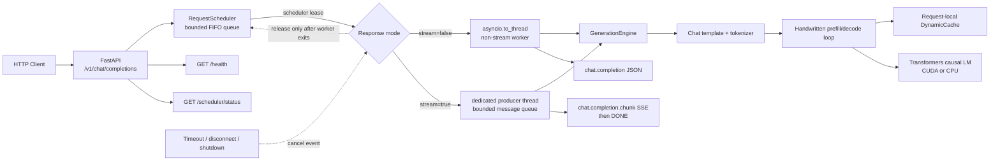

# MiniLLM-Serve

## Project Overview

MiniLLM-Serve is a compact, OpenAI-compatible LLM inference service built to make the internals of model serving visible and understandable. It combines a handwritten autoregressive generation loop, request-local KV caching, SSE streaming, and a bounded FIFO scheduler in a small FastAPI codebase.

The project targets hands-on AI infrastructure and inference engineering study. It is intentionally smaller than production systems such as vLLM or SGLang: the goal is to expose the mechanics of prefill, decode, cache lifetime, cancellation, queueing, and measurement without hiding them behind a large serving framework.

Validated locally with Qwen2.5-0.5B-Instruct on an NVIDIA GeForce RTX 5060 Laptop GPU, PyTorch 2.11.0+cu128, CUDA 12.8, Transformers 5.17.0, and Accelerate 1.15.0.

## Key Features

- OpenAI-style `POST /v1/chat/completions` endpoint.
- Non-streaming JSON responses with prompt, completion, and total token usage.
- Real incremental SSE streaming with `chat.completion.chunk` objects and a final `[DONE]` event.
- Handwritten batch-size-1 autoregressive generation with temperature, top-k, top-p, stop sequences, seeds, and length limits.
- Request-local Transformers `DynamicCache`: full-prompt prefill followed by single-token decode.
- Runtime KV Cache on/off switch for correctness and performance comparisons.
- Strict FIFO request admission with bounded queue capacity and configurable GPU concurrency.
- Separate queue and inference timeouts, cooperative cancellation, and client-disconnect cleanup.
- Prompt-free `/health` and `/scheduler/status` observability endpoints.
- Engine, HTTP, and bounded stability benchmark tools with JSON, CSV, and Markdown output.
- Single-worker NVIDIA GPU container, non-root runtime user, persistent Hugging Face cache, and graceful SIGTERM shutdown.
- Mock-based CPU test suite; normal tests do not download a model.

## System Architecture



The FastAPI event loop never performs model inference directly. Non-streaming work runs through `asyncio.to_thread`; streaming uses one producer thread per admitted request and transfers chunks through a bounded thread-safe queue. A scheduler slot remains occupied until the physical worker has exited, including timeout and cancellation paths.

## Quick Start with Docker Compose

### Prerequisites

- Windows with WSL2 and Docker Desktop using Linux containers.
- A current NVIDIA Windows driver with WSL2 GPU support.
- Docker Compose with NVIDIA GPU device reservations.
- Enough disk space for the CUDA runtime image and model cache.

Run all commands from the cloned project root in Windows PowerShell.

```powershell
docker version
docker compose version

docker run --rm --gpus all `
  pytorch/pytorch:2.11.0-cuda12.8-cudnn9-runtime `
  python -c "import torch; print(torch.__version__); print(torch.cuda.is_available()); print(torch.cuda.get_device_name(0))"
```

Build and start the service:

```powershell
Copy-Item .env.example .env
docker compose config
docker compose build --progress=plain
docker compose up -d
docker compose logs -f api
```

Compose publishes the service only on `127.0.0.1:8000` by default. Set `MINILLM_HOST_PORT` in `.env` if the host port is already in use.

Wait for model loading and inspect service state:

```powershell
py -3 scripts\docker_smoke.py `
  --base-url http://127.0.0.1:8000 `
  --expect-device cuda

Invoke-RestMethod http://127.0.0.1:8000/health
Invoke-RestMethod http://127.0.0.1:8000/scheduler/status
```

The first start may download the configured public model. Hugging Face files are retained in the `minillm-hf-cache` named volume and are not copied into the image. For a private model, pass `HF_TOKEN` only through the runtime environment; never add it to the Dockerfile or source control.

Gracefully stop the service:

```powershell
docker compose stop -t 300
docker compose logs --tail 100 api
docker compose down
```

`docker compose down` preserves the model cache. `docker compose down -v` also deletes the cache volume.

## Local Development

Python 3.10 or later is required. The container and CI configuration use Python 3.12. Install the PyTorch build appropriate for the target machine before installing the project.

Example Windows CUDA environment:

```powershell
py -3.12 -m venv .venv
.\.venv\Scripts\Activate.ps1

python -m pip install --upgrade pip
python -m pip install torch==2.11.0 --index-url https://download.pytorch.org/whl/cu128
python -m pip install -e ".[dev]"
```

Start the service locally:

```powershell
$env:MINILLM_MODEL = "Qwen/Qwen2.5-0.5B-Instruct"
$env:MINILLM_DEVICE = "cuda"
$env:MINILLM_DTYPE = "float16"
$env:MINILLM_USE_KV_CACHE = "true"
$env:MINILLM_MAX_CONCURRENT_GENERATIONS = "1"
$env:MINILLM_REQUEST_QUEUE_CAPACITY = "8"
$env:MINILLM_QUEUE_TIMEOUT_SECONDS = "30"
$env:MINILLM_INFERENCE_TIMEOUT_SECONDS = "180"

.\.venv\Scripts\python.exe -m uvicorn minillm.server:app `
  --host 127.0.0.1 `
  --port 8000
```

The model is loaded during FastAPI startup. Do not send inference requests until `/health` reports `loaded: true`.

Core environment variables:

| Variable | Application default | Docker Compose default | Purpose |
| --- | --- | --- | --- |
| `MINILLM_MODEL` | `Qwen/Qwen2.5-1.5B-Instruct` | `Qwen/Qwen2.5-0.5B-Instruct` | Hugging Face model ID or local path |
| `MINILLM_DEVICE` | `auto` | `cuda` | `auto`, `cpu`, `cuda`, or a device string |
| `MINILLM_DTYPE` | `auto` | `float16` | PyTorch dtype name |
| `MINILLM_MAX_MODEL_LEN` | `2048` | `2048` | Prompt plus generated-token limit |
| `MINILLM_USE_KV_CACHE` | `true` | `true` | Enable request-local KV Cache |
| `MINILLM_MAX_CONCURRENT_GENERATIONS` | `1` | `1` | Simultaneous admitted generation workers |
| `MINILLM_REQUEST_QUEUE_CAPACITY` | `8` | `8` | Waiting requests, excluding running requests |
| `MINILLM_QUEUE_TIMEOUT_SECONDS` | `30` | `30` | Maximum wait for a scheduler slot |
| `MINILLM_INFERENCE_TIMEOUT_SECONDS` | `120` | `180` | Execution timeout after admission |

## OpenAI-Compatible API Examples

MiniLLM-Serve implements the text Chat Completions subset at `POST /v1/chat/completions`.

### Non-streaming request

```powershell
$body = @{
    model = "Qwen/Qwen2.5-0.5B-Instruct"
    messages = @(
        @{ role = "system"; content = "Answer concisely." }
        @{ role = "user"; content = "用一句话解释 KV Cache。" }
    )
    max_tokens = 64
    temperature = 0.0
    top_p = 1.0
    top_k = -1
    seed = 42
    stream = $false
} | ConvertTo-Json -Depth 5

Invoke-RestMethod `
  -Uri http://127.0.0.1:8000/v1/chat/completions `
  -Method Post `
  -ContentType application/json `
  -Body $body
```

Response shape:

```json
{
  "id": "chatcmpl-...",
  "object": "chat.completion",
  "created": 0,
  "model": "Qwen/Qwen2.5-0.5B-Instruct",
  "choices": [
    {
      "index": 0,
      "message": {"role": "assistant", "content": "..."},
      "finish_reason": "stop"
    }
  ],
  "usage": {
    "prompt_tokens": 0,
    "completion_tokens": 0,
    "total_tokens": 0
  }
}
```

Supported request fields:

| Field | Default | Validation / behavior |
| --- | ---: | --- |
| `model` | required | Must match the loaded model |
| `messages` | required | Non-empty `system`, `user`, and `assistant` message list |
| `max_tokens` | `512` | 1–4096, additionally bounded by `MINILLM_MAX_MODEL_LEN` |
| `temperature` | `0.7` | 0–2; zero selects greedy decoding |
| `top_p` | `1.0` | 0–1 |
| `top_k` | `-1` | `-1` disables top-k filtering |
| `stop` | `null` | One string or 1–4 non-empty strings |
| `seed` | `null` | Request-local PyTorch generator seed |
| `stream` | `false` | Return JSON or SSE chunks |

Admission errors use an OpenAI-style error envelope. Queue saturation returns HTTP 429, queue timeout returns HTTP 503, and non-streaming inference timeout returns HTTP 504.

## SSE Streaming

Streaming uses the same token-generation loop as non-streaming inference. Content is emitted only after a model forward step; the server does not generate a complete answer and split it afterward.

Use unbuffered curl to observe events as they arrive:

```powershell
curl.exe --no-buffer `
  -X POST http://127.0.0.1:8000/v1/chat/completions `
  -H "Content-Type: application/json" `
  --data-binary '{"model":"Qwen/Qwen2.5-0.5B-Instruct","messages":[{"role":"user","content":"用三句话介绍大模型推理。"}],"max_tokens":96,"temperature":0.7,"stream":true}'
```

Event sequence:

```text
data: {"object":"chat.completion.chunk","choices":[{"delta":{"role":"assistant"},"finish_reason":null}],...}

data: {"object":"chat.completion.chunk","choices":[{"delta":{"content":"..."},"finish_reason":null}],...}

data: {"object":"chat.completion.chunk","choices":[{"delta":{},"finish_reason":"stop"}],...}

data: [DONE]
```

The server holds possible stop-sequence prefixes until they are safe to emit. Client disconnects set a request-local cancellation event. If an error occurs after SSE headers have been sent, the stream emits an error event followed by `[DONE]`; the HTTP status can no longer be changed at that point.

## Request Scheduler Design

Non-streaming and streaming requests share one in-process `RequestScheduler`:

1. An idle execution slot is granted immediately only when no older request is waiting.
2. Additional requests enter a bounded `deque` and are admitted in FIFO order.
3. A full queue fails before generation with HTTP 429 and `code="queue_full"`.
4. Queue wait timeout returns HTTP 503 and `code="queue_timeout"`.
5. Inference timeout returns HTTP 504 for non-streaming requests. An active SSE response receives an `inference_timeout` error event.
6. Waiting-task cancellation removes the waiter. Running cancellation sets a `threading.Event` checked between generation steps.
7. A CUDA kernel cannot be forcibly interrupted. The scheduler lease is released only after the underlying worker thread actually exits.
8. Shutdown closes admission, cancels queued/running work cooperatively, and waits for all running leases to settle.

Successful responses expose:

- `X-MiniLLM-Request-ID`
- `X-MiniLLM-Queue-Wait-Ms`

`GET /scheduler/status` reports running and queued requests, outcomes, wait-time aggregates, shutdown state, and available CUDA memory statistics. It does not store prompts or generated content.

## Benchmarks and Stress Tests

Published, privacy-reviewed evidence is available in the [benchmark summary](benchmarks/reports/benchmark-summary.md) and [environment and reproduction notes](benchmarks/reports/environment.md). The values are historical local snapshots recorded on 2026-10-09 and 2026-10-10; re-run the tools on the checked-out revision before using them for capacity decisions.

Benchmark tooling is split by measurement scope:

| Tool | Scope | Main metrics |
| --- | --- | --- |
| `benchmark_kv_cache.py` | Model engine | Prefill, TTFT, TPOT, tokens/s, total generation time, CUDA peak memory |
| `benchmark_http.py` | HTTP client | E2E, streaming TTFT/TPOT, P50/P95/P99, request throughput, queue wait |
| `stress_http.py` | Stability | Success/error counts, rejection/timeout/cancellation, FIFO observation, cache isolation, final scheduler idle state |

SSE chunks are not treated as tokens. The HTTP benchmark reconstructs generated text and tokenizes it locally; non-streaming token counts come from the API `usage` object.

Example bounded HTTP benchmark:

```powershell
.\.venv\Scripts\python.exe benchmarks\benchmark_http.py `
  --base-url http://127.0.0.1:8000 `
  --model Qwen/Qwen2.5-0.5B-Instruct `
  --prompt-lengths 32,256 `
  --generation-lengths 16,64 `
  --concurrency 1,2,4,8 `
  --mode both `
  --kv-cache-state on `
  --warmup 2 `
  --repeats 10 `
  --max-total-requests 500 `
  --output-prefix benchmarks\results\http-kv-on
```

Example bounded stability run:

```powershell
.\.venv\Scripts\python.exe benchmarks\stress_http.py `
  --base-url http://127.0.0.1:8000 `
  --model Qwen/Qwen2.5-0.5B-Instruct `
  --requests 20 `
  --concurrency 4 `
  --disconnect-requests 2 `
  --prompt-tokens 64 `
  --max-tokens 64 `
  --timeout 180 `
  --cleanup-timeout 30
```

Local validation evidence:

- Hardware: NVIDIA GeForce RTX 5060 Laptop GPU.
- Engine benchmark: Qwen2.5-0.5B-Instruct, FP16, greedy decoding, 2 warmups and 10 measured repetitions per case.
- HTTP acceptance run: 18/18 measured requests succeeded.
- Stability run: 20/20 load requests succeeded; 2/2 client disconnects were observed as scheduler cancellations.
- FIFO observation, consecutive-request KV Cache isolation, and final scheduler idle checks passed.
- Docker validation completed for image build, `pip check`, health, Chinese non-streaming inference, a 76-chunk SSE response ending in `[DONE]`, and graceful Uvicorn shutdown.

One representative engine comparison from that machine:

| Prompt tokens | Max new tokens | KV Cache | TTFT | TPOT | Tokens/s | Total | CUDA peak increment |
| ---: | ---: | :---: | ---: | ---: | ---: | ---: | ---: |
| 32 | 16 | Off | 24.24 ms | 24.65 ms | 40.27 | 397.35 ms | 27.03 MB |
| 32 | 16 | On | 24.68 ms | 22.72 ms | 42.52 | 376.33 ms | 10.06 MB |

These are local samples, not universal hardware claims. Laptop power limits, thermals, model choice, prompt length, and repetition count materially affect results. See [benchmarks/README.md](benchmarks/README.md) for tool usage and metric definitions. Raw generated results are intentionally Git-ignored because they can contain machine-specific data; only the curated reports under `benchmarks/reports/` are publication artifacts. The historical artifacts do not include a Git commit SHA, so they cannot be cryptographically tied to the current source revision.

## Testing

The default suite uses mocks or small tensors and does not download a model:

```powershell
.\.venv\Scripts\python.exe -m pytest -m "not slow" -q
```

Current local baseline:

```text
78 passed, 4 deselected
```

The suite covers request validation, sampling, incremental decoding, KV Cache on/off equivalence, cache isolation, stop sequences, FIFO order, queue capacity, queue and inference timeouts, cancellation, disconnect cleanup, shutdown, SSE structure, error envelopes, benchmark math, and deployment contracts.

Real-model integration tests require an available model cache or network access:

```powershell
$env:MINILLM_MODEL = "Qwen/Qwen2.5-0.5B-Instruct"
$env:MINILLM_TEST_DEVICE = "cuda"
$env:HF_HUB_OFFLINE = "1"
$env:TRANSFORMERS_OFFLINE = "1"

.\.venv\Scripts\python.exe -m pytest -m slow tests\test_integration.py -v
```

The current local CUDA integration baseline is 4 passed tests. GitHub Actions is configured to install CPU-only PyTorch and run the non-slow suite on Ubuntu with Python 3.12; the workflow has not yet been validated on a hosted GitHub runner.

## Project Structure

```text
MiniLLM-Serve/
├── .github/workflows/ci.yml       # CPU-only GitHub Actions workflow
├── benchmarks/
│   ├── benchmark_http.py          # HTTP/SSE latency and throughput
│   ├── benchmark_kv_cache.py      # Engine-side cache comparison
│   ├── benchmark_utils.py         # Metrics and report exporters
│   ├── stress_http.py             # Bounded stability probe
│   └── README.md
├── scripts/
│   ├── docker_smoke.py            # Read-only readiness check
│   ├── run_generation.py          # Early direct-generation learning script
│   └── smoke_test.py              # Simple non-streaming HTTP probe
├── src/minillm/
│   ├── config.py                  # Environment-backed settings
│   ├── engine.py                  # Generation loop and KV Cache
│   ├── scheduler.py               # FIFO admission and lifecycle metrics
│   ├── schemas.py                 # Request, response, chunk, and error models
│   └── server.py                  # FastAPI, SSE, workers, and shutdown
├── tests/                         # Unit, integration, benchmark, deployment tests
├── .dockerignore
├── .env.example
├── .gitignore
├── compose.yaml
├── constraints-container.txt
├── Dockerfile
├── LICENSE
├── pyproject.toml
└── README.md
```

## Known Limitations

- Text-only Chat Completions subset: no tool calls, multimodal input, logprobs, or streaming usage object.
- Batch size 1 and one handwritten decode loop per admitted request; no continuous batching or request merging.
- Dynamic KV Cache only; no StaticCache, PagedAttention, prefix caching, or cross-request cache reuse.
- The scheduler is process-local. Multiple Uvicorn workers would load independent models and independent queues; the Docker image intentionally uses one worker.
- Cancellation is cooperative between model steps. An active CUDA kernel cannot be interrupted immediately.
- Once SSE headers are sent, generation errors must be represented as SSE error events rather than a new HTTP status.
- Metrics are in-memory and reset on process restart; there is no Prometheus exporter or persistent telemetry backend.
- No built-in authentication or TLS. Docker Compose binds to `127.0.0.1` by default; use a secured reverse proxy before any network exposure.
- The published container target is Linux/amd64 with one NVIDIA GPU.
- Model loading occurs during application startup, and an uncached first start may require a Hugging Face download.

## Roadmap

- Static KV Cache experiments and more detailed prefill/decode profiling.
- Continuous batching and token-budget-aware admission control.
- Paged KV memory management and prefix-cache experiments.
- Prometheus-compatible metrics, structured tracing, and longer soak tests.
- Optional authentication, request-size limits, and hardened reverse-proxy examples.
- Broader OpenAI API compatibility, including streaming usage and tool-call schemas.
- Multi-GPU execution only after the single-GPU lifecycle remains observable and testable.

## License

MiniLLM-Serve is released under the [MIT License](LICENSE).

Copyright (c) 2026 BowenLab.
