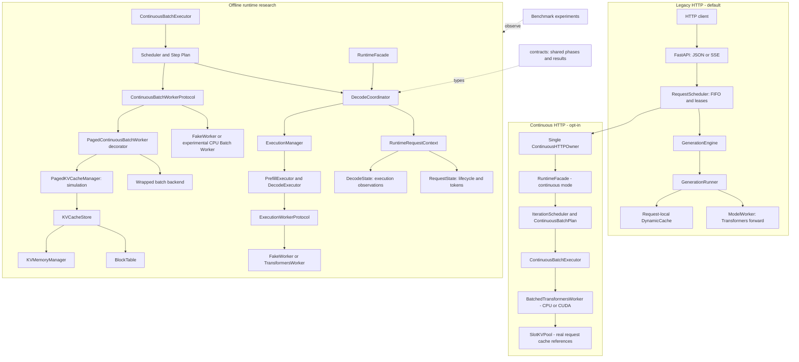

# MiniLLM-Serve

A compact Experimental LLM Serving & Runtime Research Prototype.
Explore scheduling, prefill/decode execution and KV ownership without hiding
the mechanics behind a production serving framework.

## Overview

**Research status:** Legacy is the default; Continuous HTTP JSON/SSE is an
opt-in experiment with batch size at most two. Mission 24.4.2.12 found the
draft evidence contract **INTERNALLY_INCONSISTENT**. Formal online GPU
Benchmark is **not admitted**; existing PREFLIGHT FAIL/UNKNOWN obligations
remain open. Read [current research status](docs/research/CURRENT_STATUS.md)
before using historical evidence or experiment commands.

The project separates three paths:

- **Legacy HTTP (default):** FastAPI, an OpenAI-compatible text Chat Completions subset,
  incremental SSE, handwritten autoregressive decoding, request-local KV cache
  and bounded FIFO admission.
- **Continuous HTTP (experimental):** the same JSON/SSE API and FIFO admission,
  one Runtime owner, iteration plans, a CPU/CUDA batch Worker and request KV slots.
- **Offline research:** model-independent runtime contracts, explicit request
  ownership, continuous decode-step coordination, experimental workers,
  simulated paged KV capacity and reproducible benchmark experiments.

MiniLLM-Serve is an educational engineering project, **not a production vLLM
replacement**. Simulated paged-memory and Fake Worker performance experiments
remain separate from actual HTTP/model execution.

Historical online validation used Qwen2.5-0.5B-Instruct on an RTX 5060 Laptop GPU,
PyTorch 2.11.0+cu128, CUDA 12.8, Transformers 5.17.0 and Accelerate 1.15.0.
See [published evidence](benchmarks/reports/benchmark-summary.md) and
[environment notes](benchmarks/reports/environment.md). These measurements do
not validate every later experimental backend.

## Architecture



The execution mode is selected at application startup. These HTTP branches are
alternatives, not two models loaded for every request. Offline phase executors
remain available separately. Synthetic block IDs never enter model attention.

## Features

| Area | Capability | Boundary |
| --- | --- | --- |
| API | JSON completions, token usage, incremental SSE and `[DONE]` | Online text subset |
| Generation | Temperature, top-k/top-p, stop sequences, seeds and length limits | Legacy engine; experimental batch backend is separately validated |
| KV cache | Full-prompt prefill, single-token decode, request-local DynamicCache and cache toggle | Online |
| Request management | FIFO, bounded queues, timeouts, cancellation and shutdown cleanup | Online |
| Runtime Architecture | Shared contracts, context ownership, phase validation and snapshots | Offline facade and opt-in HTTP owner |
| Continuous Batching | Active Decode requests, new Prefill admission, plans and bounded output channels | Experimental HTTP/offline coordination; batch <= 2 |
| Backend experiments | Sequential worker, CPU batch adapter and CPU/CUDA BatchedTransformersWorker | Limited full-attention cache layouts; no production-performance claim |
| KV Memory System | Capacity limits, blocks, logical mappings, token growth and release accounting | Pure Python simulation |
| Paged KV Runtime | Paged worker decorator and ordered attention block lookup | No paged attention computation |
| Deployment | Non-root GPU container, one Uvicorn worker, cache volume and readiness check | Online |
| Benchmark Experiments | Engine, HTTP, runtime, memory and scheduling tools | Separate measurement scopes |

## Design Details

### Online scheduler and streaming

JSON and SSE requests share one process-local scheduler, defaulting to one
concurrent generation and eight waiting requests. Queue full returns HTTP 429,
queue timeout 503, and non-streaming inference timeout 504. Once SSE headers
are sent, failures use error events rather than a new HTTP status.

Legacy inference runs outside the FastAPI event loop: `asyncio.to_thread` for
JSON, a producer thread and bounded queue for SSE. Continuous mode uses one
owner thread for all Runtime commands and forwards, with bounded per-request
Token channels; it does not create one GPU producer thread per request.
Cancellation is cooperative at safe model-step boundaries. Legacy leases wait
for execution to end; Continuous leases additionally require resource cleanup
and the relevant consumer/finalizer confirmation. A terminal request or empty
Slot counter alone is not cleanup proof. Active CUDA kernels cannot be forcibly
interrupted; permanent cleanup failure must not be reported as idle/drained.
`/health` and `/scheduler/status` expose readiness and aggregate state without
running inference or publishing prompt content.

### Runtime Architecture

`RuntimeFacade` provides `submit`, `step`, `cancel`, `snapshot`, `get_result`,
acknowledgement/forgetting and `close`, with legacy offline execution and explicit
continuous mode. The HTTP owner serializes its use. `RuntimeRequestContext` combines a single authoritative
`RequestState` (lifecycle, generated tokens and options), an execution-only
`DecodeState` (phase, timestamps and counters), and derived metrics.
Legacy exports remain adapters rather than independent lifecycle owners.

`ExecutionManager` delegates to phase-specific executors that validate phases,
result types and request-ID completeness. `DecodeCoordinator` applies results,
isolates request failures, distinguishes whole-worker errors and monitors
decode progress. Execution phases are separate from lifecycle status.

### Continuous Batching

The continuous executor retains unfinished Decode requests and admits waiting
Prefill requests into available slots. Stable step plans map results to request
IDs; one request finishing does not stop its peers.

`TransformersBatchWorker` supplies the CPU scaffolding; `BatchedTransformersWorker`
adds CPU/CUDA execution and SlotKVPool, and is used by the experimental HTTP
owner. Both are limited to batches of at most two and basic K/V concatenation,
padding and cloned row splitting. This is not an optimized production cache
layout. The separate `TransformersWorker` remains a sequential backend.
Historical offline, ASGI and real TCP/CUDA checks have distinct scopes; they
do not close the evidence-contract findings or authorize online performance runs.

### KV Memory System and Paged KV Runtime

`KVMemoryManager` accounts for synthetic byte capacity. `BlockTable` maps logical
sequence blocks to physical IDs in order. `KVCacheStore` maintains consistent
token counts, mappings and capacity; `PagedKVCacheManager` grows fixed-size pages.

`PagedContinuousBatchWorker` wraps a backend to reserve prompt pages, validate
decode lookup, grow accounting after a token and release on completion/error.
Callers own cleanup: close the wrapper after executor shutdown.
`PagedAttentionSimulator` only returns ordered block IDs. **Neither component
allocates GPU tensors or computes paged attention.**

### Scheduling policies

Online admission remains FIFO by default. Offline comparisons use FIFO,
Decode-first phase priority and Fair Aging. Aging adds request creation age to
phase weights (Decode 100, Prefill 50, Waiting 10), with FIFO tie-breaking.
Creation age is not time since the last token; aging does not guarantee bounded
waiting under arbitrary sustained load.

## Quick Start

<a id="quick-start-with-docker-compose"></a>

### Docker Compose — Windows PowerShell

Requires Docker Desktop with Linux containers and WSL2, an NVIDIA driver with
WSL2 GPU support, and Compose GPU device reservations. Run from the project root:

```powershell
docker version
docker compose version
if (-not (Test-Path .env)) { Copy-Item .env.example .env }
docker compose config
docker compose build
docker compose up -d
docker compose logs -f api
```

Default address: **`127.0.0.1:8000`**. Compose selects Qwen2.5-0.5B-Instruct,
CUDA FP16 and one Uvicorn worker. Additional workers load independent models and
schedulers. The container uses `/opt/venv` and reuses the base CUDA PyTorch.
Change `MINILLM_HOST_PORT` in `.env` if needed.
The shipped Compose environment selects legacy behavior. It does not forward
the Continuous mode settings or use the special early-shutdown launcher;
Continuous-container deployment is not claimed validated.

First startup may download the public model into the persistent
`minillm-hf-cache` volume. Tokens belong only in the runtime environment;
never commit `.env` or bake credentials into an image.

```powershell
Invoke-RestMethod http://127.0.0.1:8000/health
Invoke-RestMethod http://127.0.0.1:8000/scheduler/status
py -3 scripts\docker_smoke.py --base-url http://127.0.0.1:8000 --expect-device cuda
```

Wait for `loaded: true`. Send a completion request from another terminal:

```powershell
$payload = @{
    model = "Qwen/Qwen2.5-0.5B-Instruct"
    messages = @(@{ role = "user"; content = "Explain KV cache briefly." })
    max_tokens = 64
    temperature = 0.0
    stream = $false
} | ConvertTo-Json -Depth 5

Invoke-RestMethod -Uri http://127.0.0.1:8000/v1/chat/completions `
    -Method Post -ContentType application/json -Body $payload

# Stream JSON through stdin to avoid native-command quoting differences.
$payload = $payload -replace '"stream":\s*false', '"stream": true'
$payload | curl.exe --no-buffer -X POST http://127.0.0.1:8000/v1/chat/completions `
    -H "Content-Type: application/json" --data-binary '@-'
```

SSE emits assistant-role metadata, incremental `chat.completion.chunk` content,
a finish-reason chunk and `[DONE]`. SSE chunk count is not token count.

```powershell
docker compose stop -t 300
docker compose logs --tail 100 api
docker compose down
```

`down` preserves cached models; adding `-v` deletes the cache volume.

### Local development

Metadata requires Python 3.10+; Docker and CI target Python 3.12. The following
is a **new-clone CPU setup**, not a command to replace an existing CUDA setup:

```powershell
git clone https://github.com/xbowen125-commits/MiniLLM-Serve.git
Set-Location MiniLLM-Serve
if (Test-Path .venv) { throw "Existing .venv: preserve it and skip new-environment installation." }
py -3.12 -m venv .venv
.\.venv\Scripts\python.exe -m pip install torch==2.11.0 --index-url https://download.pytorch.org/whl/cpu
.\.venv\Scripts\python.exe -m pip install --constraint constraints-container.txt -e ".[dev]"
.\.venv\Scripts\python.exe -m pip check
```

These installation commands were reviewed statically, not executed during this
remediation. Preserve an existing `.venv`; do not run the CPU installation over
a working CUDA environment. CUDA users need an appropriate pre-existing CUDA
PyTorch build. The pinned Docker/CI environment uses Transformers 5.17.0;
later local Qwen CUDA correctness records use 5.19.0/float32. See the
[environment matrix](docs/research/PUBLICATION_REMEDIATION.md#environment-matrix).

Local settings read process environment variables; `.env` is a Compose input,
not an automatically loaded local configuration file. Start a **legacy** service
only with the model already cached for the following offline example:

```powershell
$env:MINILLM_MODEL = "Qwen/Qwen2.5-0.5B-Instruct"
$env:MINILLM_EXECUTION_MODE = "legacy"
$env:MINILLM_DEVICE = "cpu" # Use cuda only in a validated CUDA environment.
$env:MINILLM_DTYPE = "float32"
$env:MINILLM_USE_KV_CACHE = "true"
$env:MINILLM_MAX_CONCURRENT_GENERATIONS = "1"
$env:MINILLM_REQUEST_QUEUE_CAPACITY = "8"
$env:HF_HUB_OFFLINE = "1"
$env:TRANSFORMERS_OFFLINE = "1"
.\.venv\Scripts\python.exe -m uvicorn minillm.server:app --host 127.0.0.1 --port 8000
```

For **experimental Continuous JSON/SSE**, stop the previous process, then run
in a fresh PowerShell session (same cached model and existing environment):

```powershell
$env:MINILLM_EXECUTION_MODE = "continuous"
$env:MINILLM_MODEL = "Qwen/Qwen2.5-0.5B-Instruct"
$env:MINILLM_DEVICE = "cpu" # Or cuda with an existing CUDA build; not a benchmark.
$env:MINILLM_DTYPE = "float32"
$env:MINILLM_HOST = "127.0.0.1"
$env:MINILLM_PORT = "8000"
$env:MINILLM_USE_KV_CACHE = "true"
$env:MINILLM_MAX_CONCURRENT_GENERATIONS = "2"
$env:MINILLM_CONTINUOUS_BATCH_SIZE = "2"
$env:MINILLM_REQUEST_QUEUE_CAPACITY = "8"
$env:MINILLM_CONTINUOUS_OUTPUT_CAPACITY = "8"
$env:HF_HUB_OFFLINE = "1"
$env:TRANSFORMERS_OFFLINE = "1"
.\.venv\Scripts\python.exe -m minillm.continuous_server
```

From another terminal, verify the effective admission settings rather than
assuming an environment-variable assignment took effect:

```powershell
$s = Invoke-RestMethod http://127.0.0.1:8000/scheduler/status
$s | Select-Object max_concurrent_requests, queue_capacity, running_requests, queued_requests
$s.continuous | ConvertTo-Json -Depth 6 # Present only in continuous mode.
```

The current names are `MINILLM_MAX_CONCURRENT_GENERATIONS` and
`MINILLM_REQUEST_QUEUE_CAPACITY`; older `MINILLM_MAX_CONCURRENT_REQUESTS` and
`MINILLM_QUEUE_CAPACITY` names are not read. Mode changes require restart.
To roll back, stop the Continuous process, select `legacy` with admission 1,
and use the legacy launcher above. Shutdown may wait for actual execution and
cleanup; these examples do not claim a new service/GPU acceptance run.

Application model default is Qwen2.5-1.5B-Instruct, unlike Compose. Configuration
references: [.env.example](.env.example) and [config.py](src/minillm/config.py).

## Benchmarks

**Formal online GPU Benchmark remains blocked.** Historical reproduction
commands are not permission to run a new performance experiment. Read
[current restrictions](docs/research/CURRENT_STATUS.md) and the
[Paged Memory source-hash erratum](docs/research/PAGED_MEMORY_PROVENANCE_ERRATUM.md).

| Experiment | Measurement scope | Documentation / entry point |
| --- | --- | --- |
| Engine KV comparison | Real prefill/decode, TTFT, TPOT, throughput, CUDA peaks | [Benchmark guide](benchmarks/README.md) |
| HTTP and stress | Client latency, queue wait, disconnects and idle cleanup | [Benchmark guide](benchmarks/README.md) |
| Runtime Benchmark v2 | Fake-worker lifecycle and virtual scheduling | [Runtime guide](benchmarks/runtime/README.md) |
| Real offline worker | Sequential real-model prefill/decode; local cache required | [Real-worker guide](benchmarks/runtime/real_model/README.md) |
| Paged vs contiguous KV | Token capacity utilization and tail waste, not GPU bytes | [Experiment](benchmarks/runtime/paged_memory/experiment.py) |
| Continuous batch | Sequential vs step-level coordination under virtual costs | [Runner](benchmarks/runtime/continuous_batch/runner.py) |
| Scheduler research | FIFO vs phase priority vs aging, wait percentiles and fairness | [Runner](benchmarks/runtime/scheduler_research/runner.py) |

For separately authorized simulations, choose a fresh output directory instead
of overwriting the historical default locations. These commands were reviewed,
not executed during the publication remediation; they load no model:

```powershell
$out = "benchmarks/runtime/results/manual-simulation-$([guid]::NewGuid().ToString('N'))"
if (Test-Path $out) { throw "Output already exists: choose a new path." }
New-Item -ItemType Directory -Path $out -ErrorAction Stop | Out-Null
.\.venv\Scripts\python.exe -m benchmarks.runtime.paged_memory.report --output-dir "$out/paged-memory"
.\.venv\Scripts\python.exe -m benchmarks.runtime.continuous_batch.report --output-dir "$out/continuous-batch"
.\.venv\Scripts\python.exe -m benchmarks.runtime.scheduler_research.report --output-dir "$out/scheduler-research"
```

JSON and Markdown are written under Git-ignored `benchmarks/runtime/results/`.
Reports record configuration, metric definitions and limitations. Simulated
batch speedups depend on assumed costs; scheduler TTFT is synthetic. Jain
fairness on inverse slowdown is not a production QoS guarantee. Neither batch
execution nor aging is presumed universally better.

Historical evidence includes 18/18 successful HTTP requests, 20/20 successful
stress requests, 2/2 disconnect cancellations, FIFO/cache isolation and final
idle checks. Docker build, health, Chinese inference, a 76-chunk SSE response
ending in `[DONE]`, and graceful shutdown were manually recorded. See
[published evidence](benchmarks/reports/benchmark-summary.md) for separate scopes
and source artifacts. Those artifacts lack a source commit SHA and do not
establish current-revision production capacity.

## Testing

```powershell
$env:CUDA_VISIBLE_DEVICES = "-1"
$env:MINILLM_DEVICE = "cpu"
$env:MINILLM_DTYPE = "float32"
$env:MINILLM_EXECUTION_MODE = "legacy"
$env:HF_HUB_OFFLINE = "1"
$env:TRANSFORMERS_OFFLINE = "1"
.\.venv\Scripts\python.exe -B -m pytest -m "not slow" -q
```

Run from the repository root. Use a fresh shell before any separately authorized
GPU work because `CUDA_VISIBLE_DEVICES=-1` persists in this shell. The older
333-passed/9-deselected figure describes a historical checkpoint, not this
candidate. Actual remediation checks and their source/environment limits are
recorded in [local validation](docs/research/PUBLICATION_REMEDIATION.md).
CI configures CPU PyTorch on Ubuntu/Python 3.12; current hosted-run status
requires independent verification and is not certified by a local run.

Normal tests use mocks or small tensors without downloading models. Opt-in
real-model tests require a complete local cache; see
[real runtime tests](tests/test_real_kv_runtime.py) and the real-worker guide.

## Project Structure

```text
src/minillm/
  server.py, schemas.py, config.py  Online HTTP and settings
  engine/                         Existing generation and cache lifecycle
  scheduler/, request_queue.py    Admission and optional phase policies
  contracts/                      Shared phases, results and statuses
  runtime/                        Context ownership, adapters and facade
  execution/                      Prefill/decode contracts and executors
  batching/                       Coordinator, metrics and snapshots
  continuous/                     Persistent batches, plans and paged decorator
  workers/                        Experimental Transformers backends
  memory/                         Simulated blocks, tables and paged lookup
benchmarks/
  reports/                        Curated historical evidence
  runtime/                        Offline experiments and report generators
tests/                            Unit, slow integration and deployment tests
scripts/                          Smoke and generation helpers
```

## Limitations

- Legacy is the default batch-size-1 generation path; experimental Continuous
  HTTP is opt-in and limited to two admitted requests and two cache slots.
- No production-grade continuous batching, paged attention kernel, prefix sharing,
  tensor parallelism or multi-GPU execution.
- Simulated block capacity is not GPU allocation; block lookup is not attention.
- Experimental batched backends support at most two requests and limited cache layouts.
- Text-only Chat Completions subset: no tools, multimodal input, logprobs or
  streaming usage object.
- Cooperative cancellation cannot stop active CUDA kernels immediately.
- Permanent cleanup failure can prevent drain; bounded tests do not prove
  unconditional cleanup termination or all Runtime interleavings.
- The draft evidence contract is INTERNALLY_INCONSISTENT and formal online GPU
  Benchmark admission is blocked; see the current research status above.
- No built-in authentication or TLS. Keep loopback binding and secure external exposure.
- In-memory metrics reset on restart. Laptop samples and finite simulations do
  not establish production throughput, starvation freedom or long-run reliability.

## Roadmap

Already implemented experimental HTTP JSON/SSE is described above, not promised
as future work. Historical [SSE/network correctness evidence](docs/continuous_sse_validation.md)
and [integration notes](docs/http_continuous_integration.md) retain their dated
scope; later research restrictions take precedence over earlier next-mission
recommendations. The following items remain research directions:

- Broaden experimental backend compatibility and real-model batch correctness evidence.
- Record source revisions and expand reproducible runtime workloads.
- Study token budgets, cache pressure and fairness before broader online integration.
- Explore actual paged tensor layouts and attention backends separately from bookkeeping.
- Add longer soak tests, structured tracing and hardened deployment examples.
- Consider broader API compatibility and multi-GPU work after lifecycle correctness.

These are research directions, not implemented features or performance promises.

## License

[MIT License](LICENSE). Copyright (c) 2026 BowenLab.
