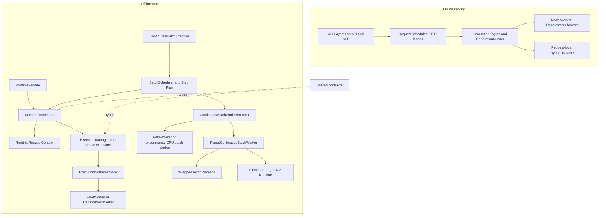
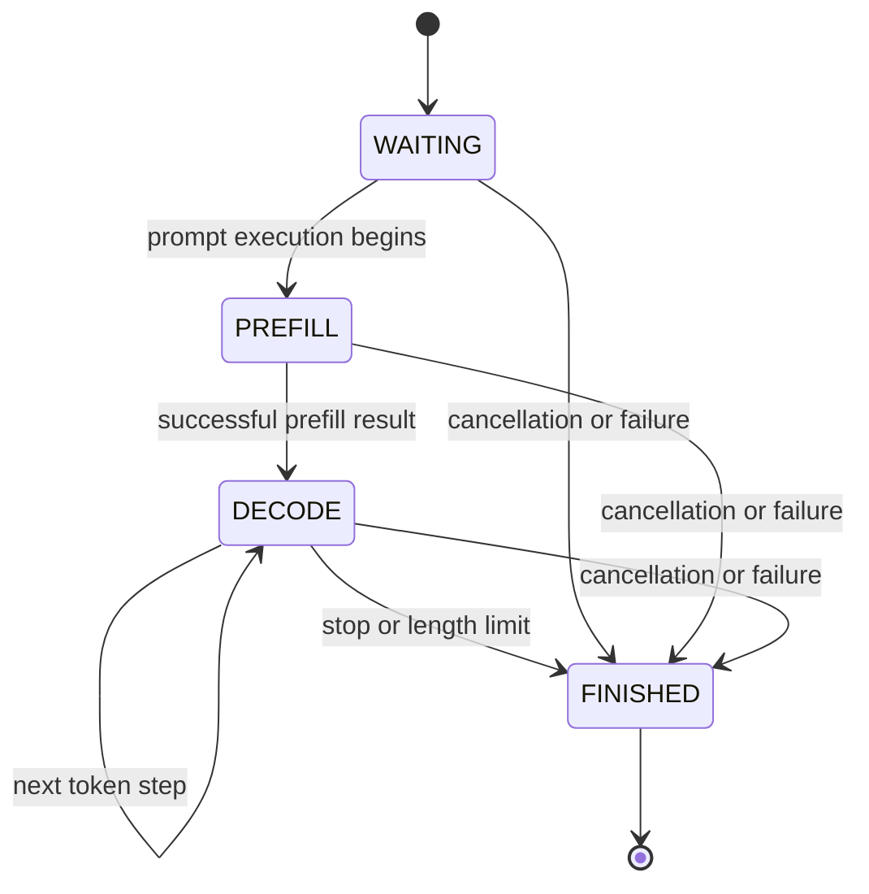
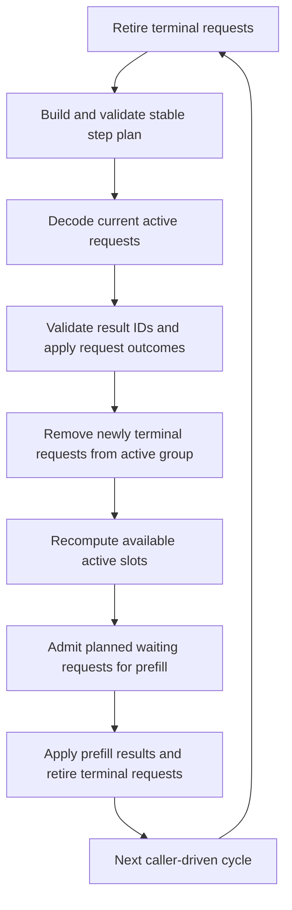
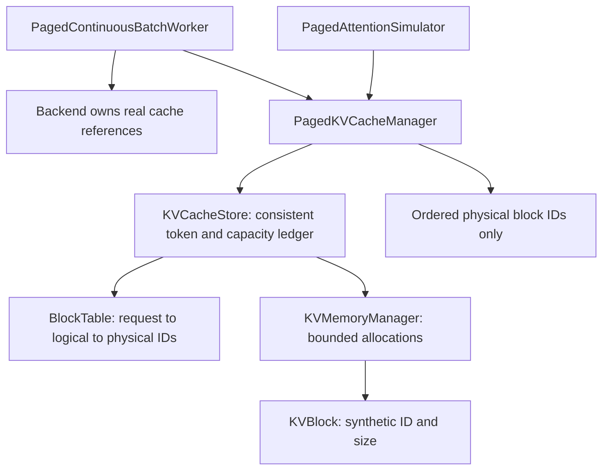

# MiniLLM-Serve Architecture

This document describes the current implementation, not a production serving
roadmap. MiniLLM-Serve combines an online inference service with separate offline
runtime experiments. See the [project overview](../README.md) for setup and
[historical evidence](../benchmarks/reports/benchmark-summary.md) for validation
provenance. Experimental scheduling and simulated memory are not part of the
HTTP inference path and do not establish parity with vLLM.

## 1. Overall Architecture



These are alternative orchestration paths. `RuntimeFacade` does not wrap the
online `GenerationEngine`, and the continuous executor is not an HTTP scheduler.

| Layer | Responsibility | Current boundary |
| --- | --- | --- |
| API Layer | Validate Chat Completions requests; format JSON/SSE; detect disconnects; manage startup/shutdown | `server.py`, `schemas.py`; no direct model forward |
| Runtime Core | Own request contexts, apply phase results, track progress/errors and expose offline snapshots/results | `runtime/`, `batching/`; manually driven offline |
| Scheduler | Online bounded FIFO admission and leases; offline phase policies and continuous batch selection | `scheduler/`, `request_queue.py`, `continuous/scheduler.py`; separate roles |
| Execution | Validate phases and result completeness; delegate prefill/decode calls; collect execution counters | `execution/`; backend-independent |
| Worker | Load/tokenize/forward/sample according to its protocol; retain and release backend cache references | Online `engine/worker.py`; experimental `workers/` |
| Memory | Account for synthetic capacity and maintain ordered request-local block mappings | `memory/`; no GPU tensor allocation |

`contracts/` defines shared phases, result types and runtime status enums without
depending on execution or batching. This avoids reverse dependencies for shared
types; higher-level orchestrators still compose the modules explicitly.

### Online execution and resource safety

Non-streaming inference runs through `asyncio.to_thread`. SSE uses a dedicated
producer thread and a bounded thread-safe queue. Both acquire the same online
scheduler lease. Queue timeout and execution timeout have different meanings:
the former limits admission waiting, the latter begins after admission.

Cancellation is cooperative between generation steps. A timeout or disconnect
does not stop an active CUDA kernel immediately. The online execution slot is
released only after the underlying worker exits, avoiding excess concurrency.
The experimental runtime described below does not replace this mechanism.

## 2. Request Lifecycle

Execution phase and request outcome are separate concepts:



| Execution phase | Meaning |
| --- | --- |
| `WAITING` | Awaiting execution; no successful prefill yet |
| `PREFILL` | Process the prompt; a real backend prepares its request cache/logits |
| `DECODE` | Advance autoregressive generation using prior execution state |
| `FINISHED` | Terminal execution phase; no further worker steps should run |

`FINISHED` phase does not imply successful completion. Authoritative lifecycle
status resides in `context.request.status`: `WAITING`, `RUNNING`, `FINISHED`,
`FAILED` or `CANCELLED`. Finish reasons include `STOP`, `LENGTH`, `ERROR` and
`CANCELLED`. Invalid phase transitions are rejected; direct WAITING-to-DECODE
execution is not allowed.

### State ownership

`RuntimeRequestContext` retains one `RequestState`, an execution-only
`DecodeState`, derived metrics and additional observations:

- `RequestState` owns the ID, prompt, generation options, lifecycle timestamps,
  status and generated token IDs.
- `DecodeState` owns execution phase, decode-step count, first/last token times
  and prefill/decode observations—not a second lifecycle or token list.
- Compatibility adapters expose legacy state views backed by the same context;
  finish reason, error and phase-history observations are not token copies.

`DecodeCoordinator.contexts` maps IDs to these contexts. Workers return results;
the coordinator applies lifecycle/token changes, including length limits and
request-scoped errors. Whole-worker failures or invalid result sets must not be
interpreted as successful partial execution. Offline runtime metrics and HTTP
client metrics have different timing boundaries.

## 3. Continuous Batching Flow

`ContinuousBatch` retains waiting, active and finished context groups.
`continuous.BatchExecutor` drives the existing offline coordinator or consumes
the batch-worker protocol directly. One cycle follows this order:



Unfinished Decode requests remain active across cycles. Waiting requests are
selected by creation-time FIFO; newly freed slots can admit Prefill candidates
from the current plan. A newly prefilled request starts decoding on a later
cycle, rather than being inserted halfway through an ongoing worker call.
One request completing or failing does not finish its peers.

There are two compatible worker routes:

- `ExecutionWorkerProtocol`: phase calls through `ExecutionManager` and the
  Prefill/Decode executors.
- `ContinuousBatchWorkerProtocol`: `prefill_batch`/`decode_batch` results are
  validated for complete, unique IDs and correct phases before application.

Logical grouping does not guarantee tensor batching. The experimental
`TransformersBatchWorker` supports CPU batches of at most two contexts, using
basic K/V concatenation and cloned cache rows. Its fake-model tests are
correctness scaffolding, not evidence of optimized real GPU batching.

### Cleanup ownership

The continuous executor owns context grouping and cancels remaining requests
when closed; its caller owns the worker. Closing the executor does **not** close
the worker. Explicitly release worker sessions or close the paged wrapper after
executor shutdown. Finished contexts can remain in the finished group for
inspection; that is distinct from keeping backend cache resources alive.

## 4. KV Memory Architecture

The real online `DynamicCache` and the simulated memory ledger are separate.
Only the former contains model K/V tensors.



| Component | Responsibility |
| --- | --- |
| `KVMemoryManager` | Allocate independent synthetic blocks within capacity; atomically reject insufficient capacity; release and report counters |
| `BlockTable` | Preserve each request's logical-block order and physical-ID mapping |
| `KVCacheStore` | Coordinate allocations, mappings and logical token counts; grow atomically and release together |
| `PagedKVCacheManager` | Register empty requests, append token counts, expose immutable ordered page-table views and snapshots |
| `PagedContinuousBatchWorker` | Couple backend phase results to simulated page reservation/growth and owned-resource cleanup |
| `PagedAttentionSimulator` | Return ordered block IDs; no attention-score calculation |

For `T` occupied tokens, block size `B` and configured bytes per token `S`:

```text
block_count = ceil(T / B)
reserved_capacity_bytes = block_count * B * S
unused_token_capacity = block_count * B - T
```

These are accounting formulas, not tensor-size measurements. Empty registered
requests have no blocks. Append operations reserve new blocks only when crossing
a boundary; capacity rejection preserves existing store token counts and mappings.
Releasing a request removes its mappings and restores simulated capacity.

The paged worker counts prompt tokens through a backend input builder or an
explicit callback, not a character estimate. Decode first checks ownership and
the page table, then delegates execution and grows accounting for returned
tokens. A capacity failure after backend execution fails that request and
releases owned resources; it does not roll back a model forward.

Synthetic block IDs are never used to address real K/V tensors. No CUDA memory
allocator, paged attention kernel, prefix sharing, block reuse optimization or
copy-on-write is implemented by this layer. Ordered lookup is a simulation of
mapping semantics, not an implementation of PagedAttention.

## 5. Experiments and Architectural Boundaries

The [benchmark overview](../README.md#benchmarks) separates:

- Real engine and HTTP measurements, with historical source evidence.
- Offline runtime/Fake Worker lifecycle experiments.
- Paged-vs-contiguous capacity simulations.
- Continuous batch virtual-cost experiments.
- FIFO, phase-priority and aging admission simulations.

Virtual costs are experimental inputs, not measured model latencies. Fair Aging
is not always better, and a finite workload does not prove starvation freedom.
The simulated memory ledger does not establish actual GPU memory savings.

Future integration would require backend compatibility checks, real tensor/cache
layout work, stronger correctness evidence and explicit cleanup guarantees.
This document does not claim production GPU continuous batching, PagedAttention,
multi-GPU serving or changes to the existing API/Docker path.
