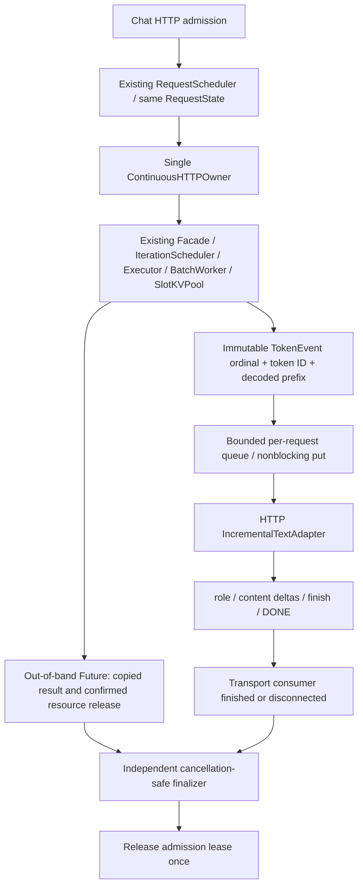

# Mission 24.3.1 — Continuous SSE and real TCP lifecycle acceptance

## Scope

Date: 2026-10-20. Opt-in execution mode remains `continuous`; default is `legacy`.
This milestone extends the existing owner, not RuntimeFacade, worker generation,
HTTP schemas, model algorithms or scheduling policy. No historical benchmark is
changed. Results below are correctness/lifecycle evidence, **not throughput or
production reliability measurements**.

## Actual execution and transport chain



Only the owner touches the tokenizer/model/backend. Each event carries the whole
decoded generated prefix as immutable text metadata, not a Context, RequestState
or KV reference. This serializes tokenizer access while allowing the HTTP adapter
to decide which text is safe to expose. There is no GPU producer thread per
request. Runtime results/claims can be forgotten after copying; the queue and
completion copy remain independently valid until the consumer ends.

### Text and SSE semantics

- One `chatcmpl-...` ID per stream, separate from the shared lease/context ID.
- Order: assistant role, zero or more content deltas, successful finish reason,
  `[DONE]`. Tokens are not equated with SSE chunks.
- Prefix decoding, word/newline/CJK flush rules and incomplete-Unicode holdback
  avoid prematurely emitting byte-fallback replacement characters. Every output
  must extend the already sent prefix; rewrites raise an explicit stream error.
- Suffixes matching any stop-string prefix are withheld across token boundaries.
  The earliest full stop match is removed, with no stop-text leak. Unmatched
  prefixes flush at a successful finish. EOS is skipped by tokenizer decoding;
  worker EOS/stop handling and actual token accounting are unchanged.
- Literal/unresolved U+FFFD at termination is conservatively an explicit decode
  error. This adapter does not claim support for arbitrary rewriting tokenizers.
- Failure, cancellation or timeout after HTTP headers yields an error envelope
  and `[DONE]`, **without** `stop`/`length`. `[DONE]` terminates transport; it does
  not assert generation success. A broken/unwritable connection cannot receive
  an error event and instead ends by disconnect/send timeout.

### Bounded backpressure and resource ownership

| Setting | Default | Meaning |
| --- | ---: | --- |
| `MINILLM_CONTINUOUS_OUTPUT_CAPACITY` | 8 | Maximum queued token events per consumer |
| `MINILLM_CONTINUOUS_SEND_TIMEOUT_SECONDS` | 10 | Timeout for each ASGI send |
| `MINILLM_CONTINUOUS_BATCH_SIZE` | 2 | Existing experimental worker batch limit |

Owner writes never block. A full queue records `stream_buffer_overflow`, submits
request cancellation and releases resources at the next safe boundary. Previously
queued events may be consumed, but the stream ends in an error, not a fabricated
normal completion. This includes overflow on the last token. No token is silently
dropped inside a successful response.

Completion is a separate Future because a queue can be full on its final token.
A disconnect only sets cancellation intent. Synchronization/release still runs
on the owner before completion confirmation. Finalizer cancellation, including
before its first execution, is translated into cancellation intent; it cannot
abandon the lease. Repeated finalization uses the existing idempotent lease.

Streaming leases are retained through output consumption as well as backend
completion. Thus completed-but-blocked clients cannot create an unlimited tail
of admitted SSE consumers. HTTP never waits for its lease finalizer before
finishing its own output (which would deadlock). A send timeout closes the body,
cancels generation and allows confirmed cleanup/finalization to settle.

Cleanup refusal retains resources and leases, logs failures, and is retried; it
does not produce false idle/drain success. A fatal owner error reports
`cleanup_unconfirmed`, leaves the lease visible and propagates shutdown failure.
There is no unconditional dictionary clearing to create zero counts.

### Network shutdown ordering

Uvicorn normally waits for HTTP handlers **before** lifespan shutdown. The new
`minillm.continuous_server.ContinuousServer` calls the public, idempotent
`app.state.begin_shutdown()` **before** `super().shutdown()` waits for handlers.
This rejects admission and sets cancellation Events while the owner/finalizers
are still running. Lifespan then verifies drain, closes the owned worker and joins
the owner thread. Tests trigger Uvicorn's real exit flag on an active TCP stream;
they do not replace this path with a direct ASGI call or a manual pre-drain.

Use the dedicated launcher below. Generic `python -m uvicorn minillm.server:app`
still works but does **not** provide this early shutdown ordering. Existing Docker
and Compose files were not changed. Raw OS termination, power loss and forced
event-loop destruction do not have a graceful-cleanup guarantee.

## Validation layers

| Layer | Backend/transport | What was checked |
| --- | --- | --- |
| Adapter unit | Pure decoding functions | Cross-token/overlapping stop, CJK, byte fragments, rewrite rejection, EOS |
| Controlled ASGI | CPU fake tensors, actual async ASGI | Overflow including last token, blocked send, timeout, header disconnect, finalizer cancellation, cleanup refusal/retry, fatal owner, repeated finalization |
| Real TCP | Uvicorn + `http.client`, CPU fake tensors | Normal/concurrent SSE, disconnect isolation, slow reader, error recovery, active shutdown, repeated cancellation, legacy SSE |
| Real CUDA + TCP | Cached Qwen on RTX 5060 Laptop GPU | Concurrent greedy equivalence, actual legacy SSE, slow-reader isolation, partial disconnect with survivor, injected backend error/recovery, active shutdown |
| Original integration regression | Real CUDA, direct ASGI / offline | Existing non-streaming HTTP and offline runtime behavior |

All socket tests bind only `127.0.0.1` on an ephemeral port, start actual Uvicorn,
and parse HTTP chunk framing and UTF-8 SSE over TCP. No TestClient substitutes for
network evidence. Each scenario has bounded request counts, deadlines and joins.

Small slow-reader responses fit OS socket buffers. Their success proves peer
progress and eventual cleanup, **not TCP buffer saturation**. Deterministic queue
overflow and blocked-send timeout are separately verified with controlled ASGI
sends. The CUDA exception is explicit test fault injection into a real Worker
step, not a claim of observing a hardware/model fault.

## Executed CUDA network evidence

Model: `Qwen/Qwen2.5-0.5B-Instruct`, cached/offline, float32. GPU: NVIDIA GeForce
RTX 5060 Laptop GPU; PyTorch 2.11.0+cu128; CUDA 12.8; Transformers 5.19.0.
Configured output capacity in CUDA acceptance: 128 events. The default 8-event
setting is exercised by smaller CPU cases; intentional overflow uses capacity 1.
This is not a comparison of these buffer configurations or GPU performance.

| Checkpoint | Accepted | Completed | Failed | Cancelled |
| --- | ---: | ---: | ---: | ---: |
| Two concurrent SSE requests | 2 | 2 | 0 | 0 |
| Slow reader and peer | 4 | 4 | 0 | 0 |
| Partial disconnect and survivor | 6 | 5 | 0 | 1 |
| Injected error, then recovery | 8 | 6 | 1 | 1 |
| Active request shutdown | 9 | 6 | 1 | 2 |

The separate legacy TCP server completed one real CUDA SSE request with text
identical to the corresponding continuous greedy output, sharing the loaded
model only while the owner was idle (no second model load or concurrent access).

At **each** checkpoint: running=0, queued=0, runtime active=0, pending commands=0,
KV slots=0, contexts=0, claims=0, released/finished IDs=0, consumers=0 and
finalizers=0. Peak simultaneously occupied slots was 2. Owner thread remains alive
while serving and is joined after shutdown; final Owner/Uvicorn thread counts are
zero. These zero-count assertions are checked after real completion, not resets.
The model and CUDA allocator can remain resident; zero KV slots does not mean zero
GPU allocated/reserved memory or prove the absence of all long-run GPU growth.

100 consecutive CPU ASGI SSE requests and 30 consecutive CPU TCP SSE requests
verify safe forgetting after consumption. A separate blocked-finish test proves
that immutable outputs remain readable after Runtime acknowledgement while the
consumer/lease is still retained. These finite tests are not an indefinite soak.

Final executed validation:

| Check | Result |
| --- | --- |
| Pre-change non-slow baseline | 410 passed, 12 deselected (11.47 s) |
| Final complete non-slow suite | 450 passed, 13 deselected (20.48 s) |
| New real TCP CPU cases | 8 passed, included in final suite |
| New adapter unit cases | 15 passed, included in final suite |
| New controlled ASGI/finalizer cases | 17 passed, included in final suite |
| CUDA real TCP SSE + original ASGI non-streaming + offline runtime | 3 passed (18.25 s) |
| `compileall -q src tests` | exit 0 |
| `git diff --check` | exit 0; Git line-ending conversion notices only |

The CUDA network test prints `TCP_CUDA_SSE_EVIDENCE` containing every checkpoint;
the ASGI regression prints `ASGI_CUDA_EVIDENCE`. Durations are test execution
times, not serving latency results. The fake Tensor/TCP cases are never counted
as CUDA evidence. Mission 23.6 JSON hashes and Mission 23.7 session manifest hashes
are checked separately to ensure historical results were not changed.

Working tree is uncommitted, based on `dc9db6e9cb2585bd7eb141717206586ec0e01fb3`;
that commit alone does not contain these changes. Windows asyncio socketpair/TCP
checks were executed outside the restrictive sandbox; no dependencies installed.

## Reproduce in PowerShell

```powershell
Set-Location D:\AI_Lab\MiniLLM-Serve
$env:HF_HUB_OFFLINE = "1"
$env:TRANSFORMERS_OFFLINE = "1"
.\.venv\Scripts\python.exe -m pytest tests/test_stream_text_adapter.py tests/test_continuous_sse.py -q
.\.venv\Scripts\python.exe -m pytest tests/test_continuous_sse_network.py -m "not slow" -q -s
.\.venv\Scripts\python.exe -m pytest tests/test_continuous_sse_network.py::test_real_cuda_tcp_sse_concurrent_disconnect_and_shutdown -m slow -q -s
.\.venv\Scripts\python.exe -m pytest -m "not slow" -q
.\.venv\Scripts\python.exe -m compileall -q src tests
git diff --check

$env:MINILLM_MODEL = "Qwen/Qwen2.5-0.5B-Instruct"
$env:MINILLM_DEVICE = "cuda"
$env:MINILLM_DTYPE = "float32"
$env:MINILLM_EXECUTION_MODE = "continuous"
$env:MINILLM_CONTINUOUS_BATCH_SIZE = "2"
$env:MINILLM_MAX_CONCURRENT_GENERATIONS = "2"
$env:MINILLM_HOST = "127.0.0.1"
$env:MINILLM_PORT = "8001"
.\.venv\Scripts\python.exe -m minillm.continuous_server
```

From another PowerShell window (ASCII payload avoids shell-encoding ambiguity;
Unicode is separately tested in automated cases):

```powershell
@'
{"model":"Qwen/Qwen2.5-0.5B-Instruct","messages":[{"role":"user","content":"Explain KV cache briefly."}],"max_tokens":32,"temperature":0,"stream":true}
'@ | curl.exe --no-buffer --http1.1 http://127.0.0.1:8001/v1/chat/completions -H "Content-Type: application/json" --data-binary '@-'
Invoke-RestMethod http://127.0.0.1:8001/scheduler/status | ConvertTo-Json -Depth 6
```

Use Ctrl+C for graceful shutdown. To roll back, restart in
`MINILLM_EXECUTION_MODE=legacy` with the previous launcher/concurrency settings.
Do not change a running model's mode.

## Remaining risks and Mission 24.4 gate

- No optimized cache layout, paged attention, new kernel or production-scale
  continuous batching is implemented. Batch size remains at most two.
- Cancellation is at synchronous batch boundaries. Large prefill/forward delays
  all cancellation; current global terminal-cleanup retry can delay other requests.
- Permanent cleanup refusal deliberately prevents idle/drain and requires
  intervention. Fatal owner failure is surfaced, not automatically recovered.
- Prefix metadata decoding adds CPU work; event queue capacity and send timeout
  are correctness controls, not tuned throughput settings. No GPU speed claim.
- Actual OS-buffer saturation, proxy behavior, process-level signal delivery on
  every deployment platform, forced kill and long-duration production soak are
  outside this acceptance. Network tests exercise the real Uvicorn exit path,
  not a signal sent to a separate operating-system process.

The demonstrated path is suitable for a **bounded, explicitly scoped** Mission
24.4 online benchmark using this launcher and fixed settings, with raw failures
and cancellations retained. It is not a production readiness or performance win.
