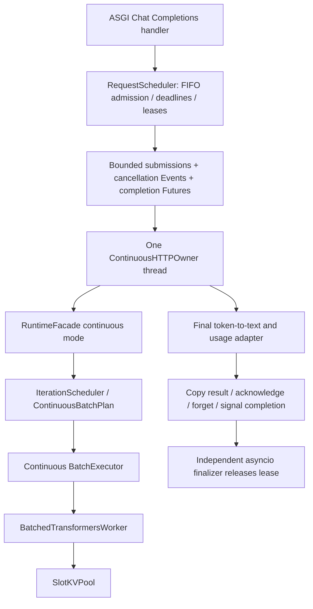

# Mission 24.3 / 24.3.1 — Experimental HTTP continuous integration

## Scope and completion boundary

An explicitly enabled JSON and **SSE** Chat Completions path now drives the
existing continuous runtime and real batched Transformers backend. Legacy is
still the default. This is correctness integration, not an online performance
claim or a production serving implementation.

Mission 24.3.1 adds bounded token channels and an append-only text adapter without
per-request GPU producers. Continuous SSE no longer returns 501. Errors after
headers use an error envelope followed by `[DONE]`, without a normal finish
chunk. See [SSE and actual TCP validation](continuous_sse_validation.md).
Legacy JSON and SSE remain unchanged and available by selecting `legacy`.

## Actual execution chain



The owner loads the engine's model once, wraps the **same** model and tokenizer in
the batch worker, and owns backend close. It does not call legacy generation.
All formatting/tokenization, facade mutation, sampling and worker calls occur on
this one thread. HTTP handlers submit transport commands only. There is no
per-request GPU producer thread. The event loop owns admission and HTTP tasks.
The bounded submission queue is not another scheduling/lifecycle implementation.

For streaming, immutable token/prefix snapshots travel from owner to a bounded
channel. HTTP performs stop/Unicode-safe text adaptation and SSE framing, without
touching Worker/cache/private Runtime state. The completion Future separately
confirms resource cleanup. Streaming admission is retained until **both** cleanup
and output consumption end, bounding slow finished consumers as well as execution.

Initialization validates `admission <= configured batch <= worker batch limit`
and slot capacity. The current worker limit is two; KV cache must be enabled.
Initialization failures propagate from lifespan; there is no automatic fallback.

## Identity and state ownership

| Identifier | Owner and mapping |
| --- | --- |
| HTTP lease ID | Scheduler generates an integer; response header `X-MiniLLM-Request-ID` |
| Generation RequestState ID | String form of that lease ID; the Scheduler creates the object |
| Runtime Context ID | Same ID, wrapping that **same RequestState instance**, not a copy |
| OpenAI response ID | `make_response()` generates a separate `chatcmpl-...` protocol ID |

Before handoff the Scheduler owns queued/admitted-but-not-submitted requests.
Continuous admission leaves the state WAITING. The owner hands it to the facade,
which alone advances generation lifecycle and tokens. Scheduler release observes
the terminal state and updates admission counters; it does not restart generation.
Legacy admission/generation behavior is unchanged.

The owner delivery map contains only in-flight transport references, Events,
deadlines and Futures. It is bounded by active leases, not a second lifecycle
ledger. Outputs are immutable copies before facade acknowledgement removes
contexts, terminal batch entries, cleanup IDs, scheduler finished-ID history and
shared-worker ID claims. Acknowledgement of active requests is rejected;
repeated acknowledgement of an absent ID is a no-op. Callers must copy results
first and must not acknowledge an ID that has been reused for a new request.

## HTTP semantics and timing

- The same engine chat template uses `tokenize=False` and
  `add_generation_prompt=True`; batch encoding keeps `add_special_tokens=True`.
- Prompt lengths at/above `max_model_len` fail. Generation is capped at the
  remaining model length. HTTP schema validation, model lookup and error envelopes
  retain existing behavior.
- Final token IDs are decoded with `skip_special_tokens=True`; text is cut at the
  earliest configured stop string. EOS/stop tokens still count toward actual
  completion usage. Worker sampling/stop/EOS behavior is not changed.
- Queue timeout covers waiting for admission. Inference deadline starts at
  admission (`lease.admitted_at`, monotonic), includes owner handoff and cleanup
  waiting, and cannot interrupt an executing forward. An over-deadline forward
  does not become a successful HTTP 200 simply because it finished its final token.
- Runtime timestamps distinguish arrival (RequestState creation), start of
  prefill, first generated token and finish. Prefill completion is not TTFT.
  `arrival_ttft_ms` includes Scheduler queue time but excludes earlier HTTP parsing;
  it is not complete network-observed TTFT. Runtime TPOT is
  `(last_token_time - first_token_time) / (decode_tokens - 1)` for at least two
  tokens. HTTP completion waits additionally for cleanup; no new HTTP performance
  metric or benchmark claim is introduced here.

## Cancellation, failures and shutdown

1. Waiting disconnect/task cancellation removes the queued request. Before
   handoff no backend resources exist.
2. Active disconnect/task cancellation, inference deadline and shutdown set a
   thread-safe cancellation Event. The owner observes it only between synchronous
   facade steps. Forward completion/synchronization precedes KV release.
3. The independent finalizer awaits a shielded delivery Future. HTTP task
   cancellation cannot cancel that Future or prematurely return its lease.
4. Request errors are isolated. Batch forward/protocol result-set failures mark
   affected contexts failed and invoke the existing executor cleanup contract.
5. Cleanup failure is logged and retained. It is retried at a bounded rate; no
   result acknowledgement or lease release occurs until release succeeds. The
   original failure is retained, not converted into a successful generation.
6. Shutdown rejects admission and signals existing leases first, while the owner
   remains alive to process cancellation/cleanup. It drains finalizers, then
   closes its owned facade/worker and joins the physical owner thread.
7. Unexpected owner death fails transport Futures with `cleanup_unconfirmed`.
   Leases remain non-idle when cleanup is unknown. Shutdown propagates failure
   instead of waiting for a dead owner to run finalizers. It does not force-free
   potentially live resources.

`/scheduler/status` adds a prompt-free cached `continuous` observation, including
pending delivery count, runtime active count, retained references and KV slots.
Health becomes unavailable if the owner is no longer ready. Observations are
boundary snapshots, not real-time CUDA execution telemetry.

## Verification

The original Mission 24.3 tests use actual ASGI routing/serialization and a real asyncio event loop. The
CPU suite uses fake tensor models; the explicit slow test loads cached Qwen on
CUDA. Those original tests are not socket-based Uvicorn deployment tests.
Mission 24.3.1 additionally executes real Uvicorn + TCP + CUDA SSE; its evidence
and remaining limitations are recorded [separately](continuous_sse_validation.md).

Coverage includes JSON/usage/Unicode/stop/EOS, concurrent/delayed arrivals,
validation before admission, queue full/queue timeout,
waiting disconnect, task/disconnect/inference/shutdown cancellation during a
blocked forward, input error isolation, missing/duplicate/unknown results,
batch exception recovery, cleanup refusal/retry, fatal owner failure, repeated
close/acknowledgement and 100 consecutive short requests with zero retained
contexts/claims/history after each request.

Real ASGI + CUDA evidence on 2026-10-20: Qwen2.5-0.5B-Instruct, float32,
RTX 5060 Laptop GPU, PyTorch 2.11.0+cu128, CUDA 12.8. Two concurrent requests
match independent legacy greedy text and prompt/completion usage; one active
client disconnect and one active shutdown cancellation complete safely. The
test asserts peak occupied slots = 2 and final occupied slots = 0. It prints
the actual evidence under `ASGI_CUDA_EVIDENCE`.

Historical Mission 24.3 validation (before the SSE additions):

| Check | Result |
| --- | --- |
| Complete non-slow suite | 410 passed, 12 deselected (12.40 s) |
| New CPU ASGI/owner contract cases | 20 passed, included in complete suite |
| New real ASGI CUDA + existing offline CUDA continuous tests | 2 passed (18.30 s) |
| `compileall -q src tests` | exit 0 |
| `git diff --check` | exit 0 (only Git line-ending conversion notices) |
| Mission 23.6 original/validity JSON hashes | unchanged |
| Mission 23.7 manifest sessions 1/2/3 hashes | all match |

Observed ASGI CUDA teardown: completed=2, cancelled=2, running=0, queued=0,
peak_allocated_slots=2, allocated_slots=0, pending=0, runtime_active_requests=0,
contexts=0, claims=0, released_ids=0, finished_ids=0. Worker thread joined.
Transformers version was separately checked as 5.19.0. Tests were run outside
the sandbox because Windows asyncio's internal socketpair initialization was
blocked inside it; no dependencies were installed.

Source basis is a **dirty, uncommitted** working tree based on
`dc9db6e9cb2585bd7eb141717206586ec0e01fb3`; this SHA alone does not reproduce
these changes. Historical Mission 23.6/23.7 benchmark files are not modified.

## PowerShell reproduction and rollback

```powershell
$env:HF_HUB_OFFLINE = "1"
$env:TRANSFORMERS_OFFLINE = "1"
.\.venv\Scripts\python.exe -m pytest tests/test_http_continuous.py -q
.\.venv\Scripts\python.exe -m pytest tests/test_real_http_continuous.py -m slow -q -s
.\.venv\Scripts\python.exe -m pytest -m "not slow" -q
.\.venv\Scripts\python.exe -m compileall -q src tests
git diff --check

$env:MINILLM_MODEL = "Qwen/Qwen2.5-0.5B-Instruct"
$env:MINILLM_DEVICE = "cuda"
$env:MINILLM_DTYPE = "float32"
$env:MINILLM_EXECUTION_MODE = "continuous"
$env:MINILLM_CONTINUOUS_BATCH_SIZE = "2"
$env:MINILLM_MAX_CONCURRENT_GENERATIONS = "2"
$env:MINILLM_HOST = "127.0.0.1"
$env:MINILLM_PORT = "8001"
.\.venv\Scripts\python.exe -m minillm.continuous_server
```

From another PowerShell window:

```powershell
$body = @{ model = "Qwen/Qwen2.5-0.5B-Instruct"; messages = @(
    @{ role = "user"; content = "Explain KV cache briefly." }
); max_tokens = 16; temperature = 0; stream = $false } | ConvertTo-Json -Depth 5
Invoke-RestMethod http://127.0.0.1:8001/v1/chat/completions -Method Post -ContentType "application/json; charset=utf-8" -Body ([Text.Encoding]::UTF8.GetBytes($body))
Invoke-RestMethod http://127.0.0.1:8001/scheduler/status | ConvertTo-Json -Depth 5
```

Stop gracefully with Ctrl+C. To roll back, restart with
`$env:MINILLM_EXECUTION_MODE = "legacy"`; use the previous concurrency setting.
Do not switch a live shared model between modes.

## Remaining limits / next gate

- Continuous streaming uses bounded channels (default 8 events) and per-send
  timeout (default 10 s). See the SSE acceptance document for cancellation,
  overflow, Unicode and network evidence. Legacy streaming is unchanged.
- Permanent backend cleanup refusal intentionally prevents idle/drain; operator
  intervention is required. Repeated cleanup failure can delay other requests
  because the facade retries terminal cleanup before another step.
- Cancellation/deadlines are cooperative at batch boundaries, not immediate
  kernel preemption. Large prefill can delay every admitted request.
- Fatal owner failures retain unconfirmed leases/resources and require service
  restart/investigation, not automatic recovery or false idle reporting.
- The backend copies/pads cache rows, supports batch <= 2, and is not optimized
  production continuous batching. No new CUDA kernel or paged attention is used.
- Actual network lifecycle validation is now provided, but no online throughput
  or production soak result is claimed. The dedicated ContinuousServer launcher
  is required for early admission shutdown; generic Uvicorn has a different drain
  order. Mission 24.4 may run bounded experiments with this explicit scope.
