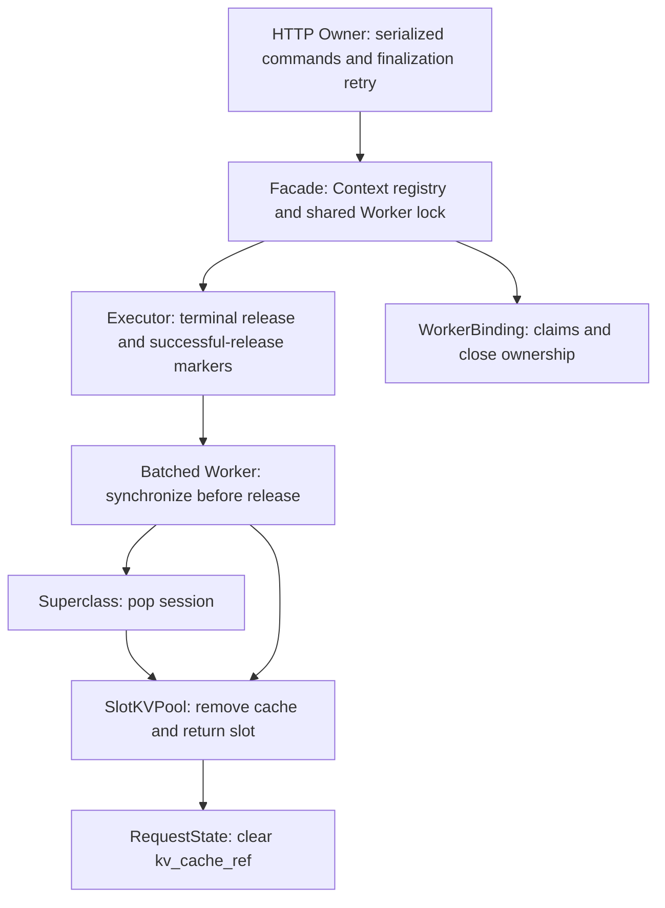

# Resource retirement model — Mission 24.4.2.5

Scope: offline evidence interpretation and deterministic CPU fault injection.
No generation, scheduler, HTTP, Worker, pool or frozen configuration changes.
This document does not authorize performance experiments.

## Actual ownership and execution order



Sources: `src/minillm/runtime/http_owner.py` finalization loop;
`runtime/resources.py::WorkerBinding`; `runtime/facade.py::cancel`,
`acknowledge`, `close`; `continuous/executor.py::_release`, `release_terminal`;
`workers/batched_transformers_worker.py::release_request`;
`workers/transformers_batch_worker.py::release_request`;
`memory/slot_kv_pool.py::release`. Paths below `src/minillm/` are shortened here.

RequestState owns lifecycle and generated tokens. Terminal state is established
before terminal resource release. Executor records `_released` only after a
successful Worker return; exceptions remain observable and retryable.
Owner does not acknowledge/finalize the HTTP lease until cleanup succeeds.
All Worker operations share the binding lock; cancellation is not interruption
of an executing forward. CUDA synchronization precedes reference release.
Borrowers release their requests, not the shared Worker; exclusive ownership
cannot be attached while another Runtime is bound. Close can fail and be retried.
Owner's repeated cleanup attempts have no finite retry bound.

## Two-dimensional model (retirement v1)

Lifecycle: WAITING, RUNNING, FINISHED, FAILED, CANCELLED, independently of:

| Resource state | Meaning |
| --- | --- |
| UNALLOCATED | No allocation observed; explicit known absence is needed for drain |
| LIVE | Cache/slot is allocated |
| RELEASE_REQUESTED | Cleanup in flight, or returned but reference retirement unconfirmed |
| RETRY_REQUIRED | Release raised; slot and/or references may still exist |
| RETIRED | Successful cleanup, observed slot absence and observed reference absence |
| UNKNOWN | Required evidence unavailable |

The immutable offline JointState also tracks slot identity, slot observability,
RequestState reference presence and successful-return confirmation. It is not a
second production lifecycle ledger. A terminal request may legally retain LIVE
or RETRY_REQUIRED resources. It is not drained. A cleanup exception after physical
removal remains unconfirmed even when the slot is absent. Unknown never means clear.

## Transition rules and evidence

| Path | Precondition and transition | Resource effect / failure evidence |
| --- | --- | --- |
| Normal | waiting → running → finished | Prefill allocates; Decode preserves ownership; release must confirm absence |
| Cancel | waiting/running → cancelled | No further Decode; release any allocated resource |
| Forward failure | running → failed | All affected requests remain terminal while cleanup is attempted |
| First cleanup failure | terminal + allocated → retry-required | Exception does not imply removal; inspect actual slot and ref |
| Repeated failure | retry-required → requested → retry-required | Same request, no new Prefill/Decode or generation count increment |
| Recovery | requested → retired | Normal return AND absent slot AND cleared actual request reference |
| Duplicate cleanup | retired → requested → retired | Idempotent Worker release; no other request's slot affected |
| Shutdown | cancel active, retry terminal cleanup, then close | Failed cleanup prevents confirmed drain/close; retry is serialized |
| Unobservable release | requested → unknown | Missing pool or reference observation cannot pass retirement |
| New arrival during failure | retained slot stays occupied | Cannot reuse that physical slot; other free capacity remains usable |
| Shared/owned close | binding ownership controls backend close | Borrowers cannot close shared backend; exclusive owner closes once |

Raw `release_begin/end`, pool events, runtime snapshots and additive
`retirement_evidence` are used. The collector reads actual RequestState objects
before and after acknowledge/close, retaining references only on the call stack.
It never modifies their fields. New release-end records include a direct
`request_cache_ref` observation. Old traces remain readable, but missing fields
are not retroactively reconstructed. Removed registry entries do not prove that
external RequestState references were cleared. Evidence collection is diagnostic
and is not a CUDA allocator-memory measurement.

## Preserved counterexample and confirmed implementation defect

Original immutable fixture:
`benchmarks/runtime/results/pytest244424-full-final/test_cleanup_failure_is_not_re0/runtime-trace.jsonl`.

* seq=19: release failed; A still owns Slot 0. This is a valid terminal/resource
  combination missing from the old Taxonomy v2 relation, not an illegal lifecycle.
* seq=20: A cancelled, `has_cache_ref=true`, Slot 0 retained.
* seq=24: release retry returns normally; slots empty.
* seq=25: A still has `has_cache_ref=true`. **Retirement reference invariant FAIL.**
* seq=27: registry empty after close. Old evidence alone does not directly observe
  the removed RequestState reference; final full reference retirement is UNKNOWN.

Cause: superclass pops `_sessions[request_id]` before `kv.release_request`.
If release raises, retry cannot find that session and skips clearing its
`context.request.kv_cache_ref`. The subclass can subsequently free the pool slot.
Executor may record successful release while a shared RequestState still holds
the cache. New CPU tests assert this defect and the checker's FAIL; they do not
hide it by expecting pool zero to suffice. Actual Facade.close clears references
for still-registered contexts, as new before-object observations verify.

No production fix is included. A separate minimal fix should preserve access to
the request reference until cleanup succeeds, preserve the original exception,
and verify retry, acknowledge and shared-Worker ownership. Returning success with
an occupied slot is separately injected and correctly classified FAIL.

## Independent recomputation and proof boundary

`python -m benchmarks.runtime.online_http.retirement DIRECTORY --output NEW.json`
verifies the sealed raw SHA-256 with the existing trace checker, recomputes
retirement evidence, and saves current source identity plus the finite graph.
Output uses exclusive creation. Historical source identity is not current-source
admission evidence. The existing general trace checker is not weakened; this
versioned check is an additional, stricter resource interpretation.

`explore()` exhausts only a one-request/one-slot graph: five lifecycle values,
six resource labels, slot ∈ {none,0}, Boolean observability/confirmation and
reference ∈ {none,false,true}. Reachable states are generated by the explicit
`successors()` relation; retry counters are quotiented away without assuming
success. No search-budget cutoff is used. The generated report gives reachable
state/edge counts and retry-cycle witnesses. This graph proves only its own
retired-state predicate and terminal no-generation rule. Slot uniqueness for
multiple requests, Worker sharing and real implementation behavior are tested,
not exhaustively proven by this graph.

**Safety:** the model can represent terminal-but-not-retired states without
claiming cleanup success. Actual raw evidence exposes a retained-reference
counterexample. **Liveness:** UNKNOWN without eventual cleanup success and fair
retry assumptions. **Termination:** not guaranteed; permanent failure admits a
reachable retry cycle. Wall clocks, HTTP admission, multiple owners, CUDA faults,
arbitrary request sets and global scheduler equivalence are outside this finite
submodel. Whole Runtime exhaustion and frozen-schedule equivalence remain UNKNOWN.

## Admission decision

PARTIALLY CLOSED: cleanup-retry representation is established; implementation
retirement correctness is not established. `RETIRED_REFERENCE_CLEARED=FAIL` on
the preserved counterexample. Historical shape blockers remain untouched.
`TAXONOMY_V2_STEP_RELATION`, `FROZEN_SCHEDULE_EQUIVALENCE` and
`FINITE_STATE_EXHAUSTION` are not promoted. No GPU preflight or performance trial
is executed for this milestone. Formal GPU Benchmark prohibition remains.

## This-run validation and artifacts

* Final full regression: **703 passed, 13 deselected** (65.67 seconds).
  Command: `.\.venv\Scripts\python.exe -m pytest -m "not slow" -q -p no:cacheprovider --basetemp benchmarks/runtime/results/pytest244425-full-b`.
* Related CPU checks: 95 passed (HTTP, SSE, continuous Runtime and trace tests).
* Reachable one-request graph: **69 states, 268 transitions, 6 drained states,
  0 unexplored**. Retry-cycle witnesses are saved, not assumed away.
* Replayed original raw SHA-256:
  `714e257fbcc609ea52a9969d6017405f8dd649ccca51e77fce266f7fae9b9087`.
* New exclusive reports live below
  `benchmarks/runtime/results/online_http/retirement244425-a/`.
  `seq19-replay-final.json` binds the final source tree; earlier replay files
  retain their own earlier fingerprints and are not overwritten.
* Historical preflight indexes: 26 + 34 files verified, zero hash mismatches.
  All 73 `src/` files from the saved source baseline are unchanged.
* `compileall` of `src`, `tests` and all 59 Git-visible Benchmark Python sources
  passed. The broad directory command also attempted ACL-protected historical
  test-result directories and printed two `Can't list` messages; the subsequent
  source-file-list compilation avoided artifacts, not source files.
* `git diff --check` passed (existing LF/CRLF normalization warnings only).
  No commit, push, model load, GPU trial or history deletion occurred.

Reproduce the original failure's independent interpretation without overwriting:

```powershell
.\.venv\Scripts\python.exe -m benchmarks.runtime.online_http.retirement `
  benchmarks/runtime/results/pytest244424-full-final/test_cleanup_failure_is_not_re0 `
  --output benchmarks/runtime/results/online_http/retirement244425-a/manual-new-replay.json
```

Results from synthetic CPU traces bind fake model identities and are not GPU
evidence. Original traces remain bound to their original PID/config/source.
Full production state equivalence, indefinite cleanup-failure recovery and
hardware resource retirement are not newly proven by these tests.
