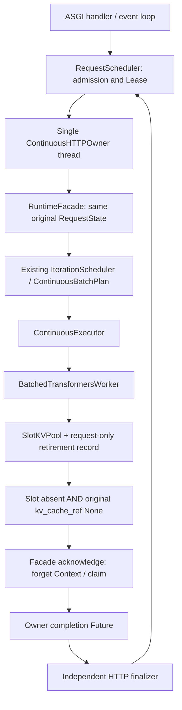

# Runtime-wide retirement composition — Mission 24.4.2.7

Scope: actual CPU/Fake ASGI, admission, Owner, Runtime and Worker composition;
raw-event recomputation; a deliberately bounded safety graph. No GPU run,
performance trial, frozen workload/threshold change or admission relaxation.

## Real ownership and call chain



The event loop owns admission and Lease counters and submits cancellation intent.
The Owner thread performs HTTP Runtime submit/step/cancel/acknowledge/close.
The finalizer waits for actual Owner completion; SSE also waits for consumer
completion before releasing its Lease. Thus resource retirement is necessary,
not by itself sufficient, for transport/admission completion.

Offline Facades may safely share a Worker using the existing WorkerBinding lock.
They are not driven by the HTTP Owner. Borrowers release only their own requests;
an exclusive Runtime closes the backend only after its requests have retired.
`Worker.close()` does not prove model-weight unload or CUDA allocator memory zero.

## Preserved new counterexamples and minimal production fix

Before-fix evidence is retained in
`benchmarks/runtime/results/pytest244427-before-b/` (two failed tests).

1. A is cancelled after Prefill, Slot cleanup fails. B has an independent valid
   Session/Slot, but `Facade.step()` throws from global `release_terminal()`
   before building the next plan. B cannot advance.
2. Cancelling/acknowledging B also invokes global cleanup and is blocked by A.

Only `continuous/executor.py` and `runtime/facade.py` production code changes:

* Step preparation retries all terminal cleanup with `strict=False`. Errors are
  still logged and stored by `_release`; no request is marked released on error.
  Independent valid sessions may advance. Existing real pool-capacity trimming
  still prevents reuse of occupied slots. Unknown pool snapshots still fail.
* cancel/acknowledge use strict cleanup restricted to the target request.
* Close retains strict all-request cleanup and cannot report success while
  retirement is unresolved.

The Worker algorithm, Scheduler/plan selection, frozen trajectory and 25ms gate
remain unchanged. This fixes cleanup coupling, not a scheduling policy change.

## Deterministic complete-chain scenarios

Real application lifespan and ASGI calls use the existing CPU tensor model and
tokenizer. Events, not timing guesses, hold Prefill, peer Decode and cleanup.
Sampling failure is injected inside the actual sampling boundary, not by changing
results after observation. Test barriers have timeouts; failed artifacts remain.

| Scenario | Evidence/assertion |
| --- | --- |
| Cancel after Prefill + repeated failure | Same RequestState retained; Lease/finalizer remain held |
| Request-local Decode error | A FAILED; B and C return HTTP 200; A returns failure only after cleanup |
| Independent B continues | Actual token count advances and B can acknowledge while A still fails |
| New C arrives | running=2, queued=1 while A/B occupy admission; no premature handoff |
| Slot/query failure | A Slot stays held; C later uses B's released slot, never A's occupied slot |
| Reference-clear failure | Pool may be empty while original reference remains; Lease/finalizer still nonzero |
| Shutdown during either failure stage | stopped Future and lifespan remain pending until explicit recovery |
| Repeated operations | cancel, cleanup retries, finalization and close remain idempotent |
| Borrowed/exclusive Worker | Borrower does not close backend; exclusive close occurs once after request cleanup |
| Final drain | Original external references None; sessions/records/claims/Contexts/Leases/finalizers/commands zero; thread stopped |

Zero `runtime_active_requests` is legal for terminal requests awaiting cleanup.
Zero queued requests is legal when no one is waiting. Neither is interpreted as
idle while a Lease, pending delivery, retirement record or finalizer remains.
An actually freed slot may be reused while a *reference-only* retirement is held;
that is different from reusing an occupied or unobservable owned slot.

## Raw observations and independent checks

`runtime_trace.py` adds real Lease grant/release snapshots, Owner publications,
Worker-close ownership boundaries, thread IDs, pending cleanup records and direct
retirement-reference-to-cache identity. IDs come from original execution objects.
Diagnostic iteration IDs are collector-scoped to avoid collisions when two
borrowed Facades each execute their first step; real Scheduler iteration IDs are
still recorded separately. No execution decision uses these diagnostic IDs.

`retirement_composition.py` reuses the retirement checker and sealed raw hash
verification. It does not trust saved PASS flags. Checks:

| Reason code | Predicate |
| --- | --- |
| COMPOSED_IDENTITY | Original RequestState agrees across Context, retirement and Lease |
| RECOVERABLE_RETIREMENT | Failed cleanup retains Session or original-request record; confirmation agrees with pool |
| LEASE_AFTER_RETIREMENT | No new Lease release before terminal state and both cleanup confirmations |
| NO_FALSE_IDLE | Unconfirmed retirement cannot hide pending delivery/Lease/finalizer |
| COMPOSED_CACHE_OWNERSHIP | Slot directly matches either live Session reference or retained retirement reference |
| OWNER_SERIALIZATION | Actual HTTP Worker operations occur on the identified Owner thread |
| WORKER_CLOSE_OWNERSHIP | Borrowers never close shared backend; exclusive backend close follows request retirement |
| COMPOSED_FINAL_DRAIN | Direct final resource/reference observations and stopped thread all confirm drain |

Missing required evidence is UNKNOWN; contradictory evidence is FAIL. Synthetic
mutation tests cover early Lease release, lost identity/records, wrong thread,
false idle, borrowed backend close, false Slot confirmation and missing final data.
Standalone borrowed-runtime tests intentionally have no HTTP Lease/Owner proof;
their ownership check can pass without claiming full HTTP composition PASS.

The existing v2 trace checker remains unchanged. Its cleanup-state
`CACHE_OWNERSHIP`, `OBSERVED_ABSTRACT_STATE_DOMAIN` and/or
`V2_CLEANUP_RETRY_REPRESENTATION` may remain UNKNOWN. The new checks provide
additional request-retirement evidence, not a rewrite of those historical flags.

## Explicit bounded model

`explore()` has two ordered requests; each has lifecycle
{new, waiting, running, finished, cancelled, failed}, resource
{unallocated, live, pending, retry, unknown, retired}, Lease
{none, queued, held, released}, actual slot/reference booleans, Context and
completion booleans, remaining tokens {0,1,2}, attempts {0,1,2+}.
Owner is {open, closing, stopped}; ownership {borrowed, owned}; backend-close
Boolean; one cleanup target {-1,0,1}. Capacity: one running Lease, one physical
slot, one queue entry. Two-plus attempts are a retry-count quotient, not a limit.

During synchronous cleanup, admission/shutdown intent can arrive, but no other
Owner forward executes until that operation returns. Transitions cover admission,
handoff, bounded Decode, cancellation/failure, cleanup begin/results, unknown
observations, acknowledgement, Lease finalization and owned/borrowed shutdown.
Success is defined only after both cleanup conditions are confirmed. Queued
requests cancelled before handoff have no Worker resource ownership.

The finite graph exhausts **5,746 states / 12,792 transitions / 242 stopped-owner
states / 0 unexplored states**. There are **720 retry-cycle witnesses**. The graph
satisfies its defined capacity, no-early-Lease-release and ownership predicates.
Safety checks exhaust this graph, not the concrete Runtime. Two-active-request
independence is demonstrated by actual tests, not this single-slot graph.

No tensor contents, real time, arbitrary clients/requests, forced termination,
unknown backend behaviors, unbounded error-history contents or full HTTP/Runtime
transition equivalence are modeled. Repeated cleanup errors can grow the current
diagnostic error history; that is not bounded by this safety abstraction.

## Reproduction and admission boundary

```powershell
.\.venv\Scripts\python.exe -m pytest tests/test_runtime_retirement_integration.py tests/test_retirement_composition.py -q
.\.venv\Scripts\python.exe -m pytest -m "not slow" -q
.\.venv\Scripts\python.exe -m benchmarks.runtime.online_http.retirement_composition `
  benchmarks/runtime/results/pytest244427-full-final/test_owner_admission_finalizat0 `
  --output benchmarks/runtime/results/online_http/retirement244427-a/manual-new-replay.json
```

Output is exclusively created. Six final composition reports and their complete
bounded graphs are saved separately in the new `retirement244427-a` directory.
Before-source identity is recorded in `source-before.json`; raw traces bind actual
current source/PID/run identity and explicitly synthetic model/config identities.
These are not CUDA or current-source GPU preflight certificates.

Safety: evidence supports the stated serialized retirement/Lease contracts.
Liveness requires eventual cleanup observability/success, fair retry, and client
finalization. Permanent failure can prevent shutdown indefinitely. Unconditional
termination is **not proven**. Overall result: **PARTIALLY CLOSED**.

No admission gate is promoted. Historical PREFLIGHT_DECLARED_PASS,
PREFLIGHT_WARMUP_SHAPES_COVERED, PREFLIGHT_WARMUP_COVERAGE and
PREFLIGHT_SHAPE_PROOF_RECORDED blockers remain historical FAIL; full
TAXONOMY_V2_STEP_RELATION, FROZEN_SCHEDULE_EQUIVALENCE and FINITE_STATE_EXHAUSTION
remain UNKNOWN. Historical undeclared-shape/expectation-completeness evidence is
untouched. Formal GPU Benchmark remains prohibited.
